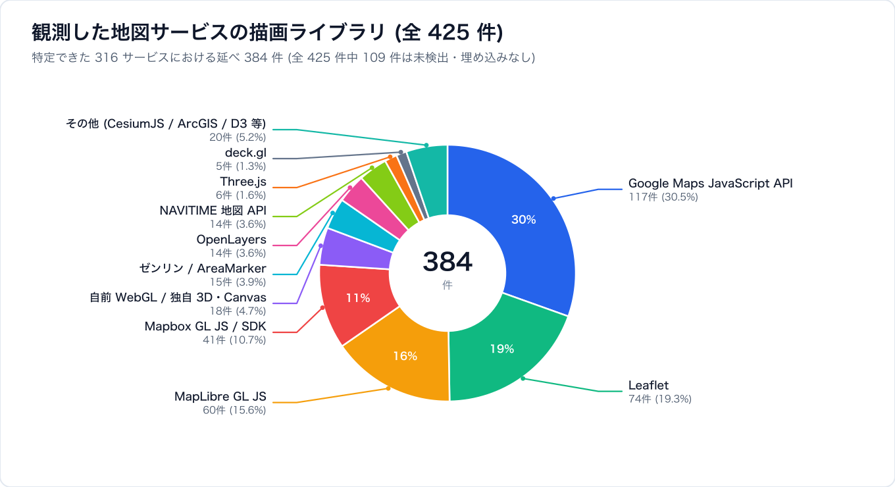
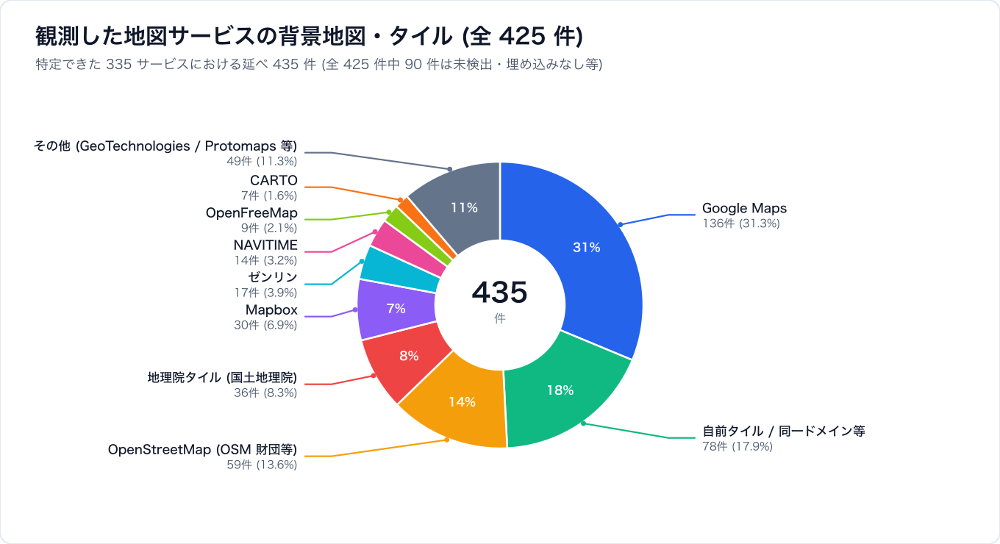
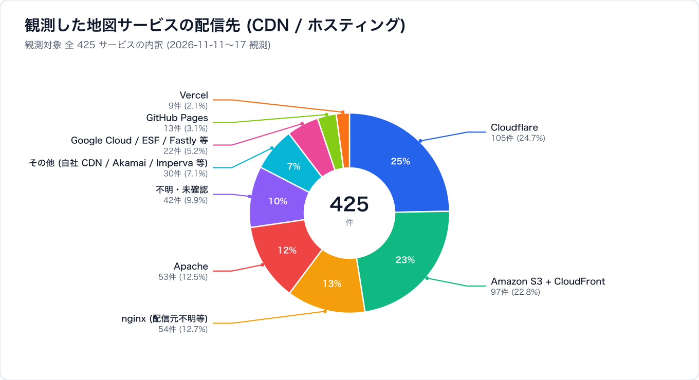

# 観測した地図サービスのカード

公開されているウェブの地図サービスを、ヘッドレスのブラウザで開き、1 サービス 1 枚のカードにしたもの。ウェブの地図とアプリの両方があるもの (YAMAP、OsmAnd、Zoom Earth など) もここに置き、アプリのストアの表示を同じカードに書く。ストアのアプリが本体のもの (ウェブは紹介のページだけのものを含む) は [../apps/](../apps/README.md) に置く。似たサービスを探すとき (SKILL.md の手順 3、4) は、まずここを見て、同じサービスを調べ直さない。

各カードは 2 つの節からなる。

- どんなサービスか: 一行で、提供する価値、想定する利用者、商用か非商用か、推定の売上、運営、推定の運用費。似たサービスと比べて、作るかどうか、何で違いを出すかを決める材料
- 技術: 種類 (ウェブ、アプリとウェブ)、描画のライブラリ、フレームワーク、背景の地図とタイル、投稿やデータの保存先、配信。後の段階 (arch、infra、library) の参考。アプリはストアの表示 (販売元、価格とアプリ内課金、評価の数、ダウンロード数、初出と最新の更新) も書く

## 統計まとめ

このディレクトリに収録した **425 件** の地図サービスカード (2026-11-11〜17 観測、日本の主要チェーン店舗検索や一般の不動産・グルメ・旅行予約・観光サイトの埋め込み地図、個人開発サービスを含む) を集計した傾向。1 つのサービスで複数を使っている場合はそれぞれ数えている。

### 使われている地図ライブラリの傾向

描画ライブラリを特定できた **316 サービス (延べ 384 件)** (未検出・未確認・埋め込みなし 109 件) の内訳では、国内主要チェーンの店舗検索や一般のグルメ・不動産・予約サイトを幅広く含めたことで **Google Maps JavaScript API** (117 件・30.5%) が最多となり、次いで **Leaflet** (74 件・19.3%、OSM 採用の大手小売や ONE COMPATH / Canly 基盤の店舗検索を含む)、**MapLibre GL JS** (60 件・15.6%)、**Mapbox GL JS / SDK** (41 件・10.7%) が続く。国内法人向けでは **ゼンリン / AreaMarker** (15 件・3.9%) や **NAVITIME 地図 API** (14 件・3.6%) の採用も目立つ。

| 描画ライブラリ | 件数 | 傾向 |
|---|---:|---|
| Google Maps JavaScript API | 117 | 延べ 384 件中 30.5%。グルメ、不動産、旅行、国内外の店舗検索・ストアロケーター (GOGA・Canly 含む)、Street View 系地理ゲーム等で強い |
| Leaflet | 74 | 同 19.3%。個人開発、災害・防災マップ、歴史地図比較、OSM 採用チェーン (イトーヨーカドー・平和堂・コーナン等)、ONE COMPATH / Canly (やよい軒・大戸屋・三菱UFJ・みずほ等) で広く利用 |
| MapLibre GL JS | 60 | 同 15.6%。ベクトルタイルや 3D、PMTiles との相性から新規・商用・個人・OSS を問わず主流 |
| Mapbox GL JS / SDK | 41 | 同 10.7%。不動産、海外アウトドア、トラッキング、開発者向けプラットフォーム、サンドラッグ等で利用 |
| 自前 WebGL / 独自 3D・Canvas | 18 | 同 4.7%。F4map、Google Earth (Wasm/WebGL)、Ventusky、Naver/Kakao/Baidu/Amap、MapFan 等 |
| ゼンリン / AreaMarker | 15 | 同 3.9%。セブン-イレブン、ローソン、デイリーヤマザキ、しまむら、セリア、ホンダ等の店舗検索 ASP や避難施設等 |
| OpenLayers | 14 | 同 3.6%。公的機関のシステム、地球観測・気象・航空機追跡・OSS ルーティング基盤等 |
| NAVITIME 地図 API | 14 | 同 3.6%。スターバックス、イオン、ニトリ、サイゼリヤ、吉野家、ドトール、ウエルシア、成城石井、セブン銀行など国内大手チェーンの店舗・ATM 検索で採用 |
| Three.js | 6 | 同 1.6%。3D 地球儀や独自の空間表現 |
| deck.gl | 5 | 同 1.3%。CARTO、kepler.gl、Felt、iOverlander など大規模空間データ可視化 |
| その他 | 20 | CesiumJS、ArcGIS Maps SDK、D3.js / SVG、HERE、Bing Maps Web Control、Mapillary JS、GeoTechnologies 等 |

### 使われている地図インフラの傾向

背景の地図・タイルを特定できた **335 サービス (延べ 435 件)** (未検出・埋め込みなし等 90 件) では、店舗検索や埋め込み地図を含めたことで **Google Maps** (136 件・31.3%) が最多となり、**自前のタイル配信** (78 件・17.9%)、**OpenStreetMap** (59 件・13.6%)、**地理院タイル** (36 件・8.3%)、**Mapbox** (30 件・6.9%)、**ゼンリン** (17 件・3.9%)、**NAVITIME** (14 件・3.2%)、**OpenFreeMap** (9 件・2.1%)、**CARTO** (7 件・1.6%) が続く。

| 背景の地図・タイル | 件数 | 傾向 |
|---|---:|---|
| Google Maps | 136 | グルメ・不動産・旅行予約・店舗検索・Street View 系ゲームなどの埋め込み地図やリンク先等で広く利用 |
| 自前タイル / 同一ドメイン等 | 78 | Cloudflare R2、Amazon S3 + CloudFront、自前サーバー、PMTiles 等で直接配信 |
| OpenStreetMap (OSM 財団等) | 59 | Leaflet / MapLibre との組み合わせやコミュニティ系・個人開発・OSS・大手小売チェーン (イトーヨーカドー・平和堂・コーナン・クリエイト・紀伊國屋書店等) で利用 |
| 地理院タイル (国土地理院) | 36 | 国内サービス・個人開発における背景図・航空写真・標高データ・防災マップの定番 |
| Mapbox | 30 | スタイルや各種 API の利用 |
| ゼンリン | 17 | 国内の拠点案内・店舗検索 (AreaMarker、佐川急便、西濃運輸、しまむら、セリア、いつもNAVI 等) で利用 |
| NAVITIME | 14 | 国内大手チェーンの店舗・ATM 検索 (スターバックス、イオン、ニトリ、セブン銀行、イオン銀行等) で利用 |
| OpenFreeMap | 9 | MapLibre GL JS と組み合わせて無償で使えるベクトルタイル基盤として採用が多い |
| CARTO | 7 | ダーク/ライトのベースマップ (Basemaps) として利用 |
| その他 | 49 | GeoTechnologies / ONE COMPATH (Mapion)、Protomaps、Esri / ArcGIS、HERE、USGS / NASA / Copernicus、Geolonia、MIERUNE、MapTiler 等 |

配信先 (CDN / ホスティング、全 425 件) は **Cloudflare** (105 件・24.7%) が最多で、次いで **Amazon S3 + CloudFront** (97 件・22.8%)、**nginx (配信元不明等)** (54 件・12.7%)、**Apache** (53 件・12.5%)、**不明・未確認** (42 件・9.9%)、**その他 (自社 CDN・Akamai・Imperva 等)** (30 件・7.1%)、**Google Cloud / ESF / Fastly 等** (22 件・5.2%)、**GitHub Pages** (13 件・3.1%)、**Vercel** (9 件・2.1%) となっている。

## ソースの行

コードを公開しているサービスには、冒頭の URL の下に「ソース」の行がある。リポジトリ、ライセンス、CI とテストの有無を書く (2026-11-13 に 27 件を確かめた)。コードが見えても、ライセンスの表示が無いものは OSS ではない (使う、写す、改変する許しが無い)。GPL 系のものは、テストと CI の中身を読んでいない。非 GPL の OSS のテストと CI の作り方は、geo-software-tdd の材料にした。

## カードを探すとき

カードの名前と、探す人が思い浮かべる語は違うことが多い (例: 「生活利便性マップ」を「生活便利」で探すと、字の順が違うので見つからない)。各カードの冒頭の「探すときの語」に、言い換え、上位の語、英語を並べてある。[../../scripts/find_cards.py](../../scripts/find_cards.py) に語を並べて渡すと、両方のディレクトリのカードを、どんなサービスかの部分 (名前、探すときの語、一行で、提供する価値、想定する利用者) で引き、一致した語の多い順に並べる。全角と半角、大文字と小文字は区別しない。見つからなければ、語を言い換えてもう一度引く。

## 読むときの注意

- 技術は 2026-11-11 (2026-11-12 に足した 13 枚は 2026-11-12)、どんなサービスかは 2026-11-12 の観測で、その後に作りが変わっていることがある。結論に使う前に、そのサービスを開き直す
- 各カードの末尾の「データの出どころ」は、地図の帰属表示 (縮めて表示するボタンは開いた) と、ページの本文の最後の 500 字を読んで書いた (2026-11-12)。出典は画面の最下部にあることが多い。「見えなかった」は、地図の画面の中に描かれている、別のボタンやページにある、の可能性を残す
- どんなサービスかの観測では、ページの文字を本文の先頭の約 2,500 字と、フッターの要素の中しか読んでいなかった。地図の画面の最下部に出る出典の一覧は、この範囲から外れて途中で切れることがある (例: [生活利便性マップ](seikatsu-map.md) の出典は 9 つあったが、最初は 2 つしか拾えなかった)。データの出どころは、画面の最下部と帰属表示を開いて全部読む
- 外から見えた範囲だけを書いている。どんなサービスかは、トップページと、運営者、料金、寄付、特定商取引法の表記のページ (見つかったものだけ) を読んで書いた。「見つからなかった」は「使っていない」ではない (1 つにまとめた JavaScript の中や、別のページにある地図は見えない)
- 描画のライブラリは、ページの DOM (`maplibregl-map` などのクラス) と、読み込んだ JavaScript の中の文字列で判定した。版は JavaScript の中に版の文字列が見えたときだけ書いた
- 配信は応答ヘッダー (`server`、`cf-ray`、`x-vercel-id`、`x-github-request-id`、`x-amz-cf-id` など) で判定した。Cloudflare はプロキシとして前に置かれるので、その後ろの配信元は分からないことがある
- 背景の地図は、読み込んだタイルとスタイルの通信先で判定した
- 寄付も商用に含める。広告、有料プラン、アプリの課金、寄付、本業への集客 (企業の宣伝) のどれかが見えたら商用とした。見えなかったものは「非商用と見られる」とし、断定していない
- 売上と運用費は、運営者が公表していればその数字と出どころを書いた (例: [国会議員マップ](kokkaimap.md))。公表していなければ「推測」と書き、根拠 (広告の有無、はてなブックマークの件数、配信の構成) を添えた。推測の金額は桁の目安で、確かめた値ではない
- 運用費の推測は、技術の節で見えた構成から積み上げた。静的配信 (GitHub Pages、Cloudflare Pages) と無料のタイル (地理院タイル、OpenFreeMap) は 0 円、Google Maps JavaScript API は月 1 万ロードを超えると 1,000 回あたり 7 USD、Mapbox GL JS は月 5 万ロードまで無料 (単価は [geo-software-infra の providers](../../../geo-software-infra/references/providers/) の 2026-11-10 の値)。人の時間と開発の費用は含めていない
- はてなブックマークの件数は、カードの URL そのものへのブックマークの数 (2026-11-12、はてなブックマークの件数取得 API)。別の URL へのブックマークは数えていないので、話題の大きさの目安にとどまる
- アプリもあるカードのアプリの部分の読み方は [../apps/README.md](../apps/README.md) の注意と同じ
- 開けなかったもの (2026-11-11): historydraft.com (403)、ワールドトレインマップ (403)、platinumaps (403)、思い出地図 (名前を引けなかった)

## 一覧

「運営」と「商用か」は、カードの欄の括弧の前だけを抜いたもの。根拠と金額はカードを読む。

| カード | 種類 | 運営 | 商用か | 描画 | 配信 |
|---|---|---|---|---|---|
| [2GIS](2gis.md) | アプリとウェブ | 企業 | 商用 | 独自描画エンジン | nginx |
| [無料の商圏分析・統計データマッピング｜47maps](47maps.md) | ウェブ | 企業 | 商用 | Mapbox GL JS | Amazon S3 + CloudFront |
| [ABCマート 店舗検索](abc-mart-store.md) | アプリとウェブ | 企業 | 商用 | 未確認 | Amazon CloudFront |
| [ACLED](acled.md) | ウェブ | 非営利団体 | 非商用 | 未確認 | Cloudflare |
| [ADS-B Exchange](adsbexchange.md) | ウェブ | 企業 | 商用 | OpenLayers + HTML5 Canvas | Cloudflare (`server: cloudflare`, `cf-ray` ヘッダーを確認) |
| [adsb.lol, unfiltered flight tracking](adsblol.md) | ウェブ | 個人 | 商用 | OpenLayers | Istio (Kubernetes) の後ろ |
| [イオングループ 店舗一覧・店舗検索](aeon-store.md) | ウェブ | 企業 | 商用 | NAVITIME 地図 API | nginx (`server: nginx`) |
| [イオン銀行 店舗・ATM検索](aeonbank-locations.md) | ウェブ | 企業 | 商用 | NAVITIME Location Cloud | Apache (`server: Apache`) |
| [Airbnb](airbnb.md) | ウェブ | 企業 | 商用 | Google Maps JavaScript API と Mapbox の併用 | Envoy プロキシおよび自社 CDN ドメイン `a0.muscache.com` |
| [AllTrails](alltrails.md) | ウェブ | 企業 | 商用 | Mapbox | nginx + Amazon CloudFront |
| [高徳地図 (Amap / AutoNavi)](amap.md) | アプリとウェブ | 企業 | 商用 | WebGL および独自レンダリングパイプライン | Tengine + Alibaba Cloud |
| [Amazon ロッカー／カウンター検索](amazon-locker.md) | アプリとウェブ | 企業 | 商用 | 未確認 | Amazon CloudFront |
| [安楽亭 店舗検索](anrakutei-store.md) | ウェブ | 企業 | 商用 | 未確認 | Apache |
| [AOKI 店舗検索](aoki-store.md) | ウェブ | 企業 | 商用 | Google Maps | nginx + Amazon CloudFront |
| [洋服の青山 店舗検索](aoyama-store.md) | ウェブ | 企業 | 商用 | Google Maps JavaScript API | Amazon CloudFront |
| [ArcGIS Online](arcgis-online.md) | アプリとウェブ | 企業 | 商用 | ArcGIS Maps SDK for JavaScript | ArcGIS Online サーバー + Amazon CloudFront |
| [アットホーム (at home)](athome.md) | ウェブ | 企業 | 商用 | 未確認 | Amazon CloudFront |
| [Atlas Obscura](atlas-obscura.md) | アプリとウェブ | 企業 | 商用 | 未確認 | Cloudflare |
| [オートバックス 店舗検索](autobacs-store.md) | アプリとウェブ | 企業 | 商用 | Google Maps | Cloudflare |
| [百度地図 (Baidu Maps)](baidu-maps.md) | ウェブ | 企業 | 商用 | WebGL ベースの独自エンジン | 百度フロントエンド (`Server: bfe` ヘッダーを確認) |
| [クマ遭遇AI予測マップ｜上智大学 深澤研究室](bear-ai.md) | ウェブ | 大学の研究室 | 非商用 | - | GitHub Pages |
| [ベルク 店舗情報・チラシ](belc-store.md) | ウェブ | 企業 | 商用 | トップ | nginx + Varnish キャッシュ |
| [ビックカメラ 店舗検索](biccamera-store.md) | アプリとウェブ | 企業 | 商用 | 埋め込み地図なし | 未確認 |
| [Bikemap](bikemap.md) | アプリとウェブ | 企業 | 商用 | 未確認 | nginx + Amazon CloudFront |
| [びっくりドンキー 店舗検索](bikkuri-donkey-store.md) | アプリとウェブ | 企業 | 商用 | Google Maps | Amazon S3 + Amazon CloudFront |
| [Bing Maps (Bing 地図)](bing-maps.md) | ウェブ | 企業 | 商用 | 未確認 | Microsoft Azure / CDN |
| [Booking.com](booking.md) | ウェブ | 企業 | 商用 | 未確認 | Amazon CloudFront + Istio/Envoy |
| [ブックオフ 店舗検索](bookoff-store.md) | ウェブ | 企業 | 商用 | 店舗詳細ページにて iframe 埋め込み | Amazon CloudFront + Apache |
| [バーガーキング 店舗検索](burgerking-store.md) | ウェブ | 企業 | 商用 | Google Maps | nginx + Amazon CloudFront |
| [浸水センサ表示システム（国土交通省）](c-sensor.md) | ウェブ | 公的機関 | 非商用 | OpenLayers | CloudFront 経由 (nginx/1.14.1) |
| [カインズ 店舗検索](cainz-store.md) | アプリとウェブ | 企業 | 商用 | Google Maps | Amazon CloudFront |
| [CalTopo](caltopo.md) | ウェブ | 企業 | 商用 | Leaflet | 自社配信と推測されるが、応答ヘッダーに `server` や CDN の明示的な表記はなく未確認 |
| [キャンドゥ 店舗検索](cando-store.md) | ウェブ | 企業 | 商用 | Leaflet | Amazon CloudFront |
| [CARTO](carto.md) | ウェブ | 企業 | 商用 | deck.gl | Google Cloud (`server: UploadServer` を確認) |
| [Custom Sydney Maps - Floor Plans On A Map](castlemap.md) | ウェブ | 個人 | 商用と見られる | - | Apache/2.4.58 (Ubuntu) (配信先の事業者は不明) |
| [カワチ薬品 店舗検索](cawachi-store.md) | ウェブ | 企業 | 商用 | Google Maps JavaScript API | Cloudflare + Varnish |
| [CellMapper](cellmapper.md) | アプリとウェブ | 個人・コミュニティ運営 | 商用 | OpenLayers 10.9.0 + ol-mapbox-style 13.5.1 | Apache |
| [Cesium ion](cesium-ion.md) | ウェブ | 企業 | 商用 | CesiumJS | Amazon S3 + Amazon CloudFront |
| [全国地番マップ｜公図（法務局地図）・地番図を全国で検索・ダウンロード](chiban.md) | ウェブ | 団体 | 商用 | MapLibre GL JS | Cloudflare |
| [ChicagoCrime.org](chicagocrime.md) | ウェブ | 個人 | 非商用 | 接続不可 | 接続不可 |
| [CHINTAI](chintai.md) | アプリとウェブ | 企業 | 商用 | 未確認 | 未確認 |
| [ChizuZu - 地図比較アプリ](chizuzu.md) | ウェブ | 個人と見られる | 非商用 | Leaflet | Cloudflare |
| [JR東海道本線（東京〜熱海）｜吉田初三郎風・鳥瞰路線図](chokanzu.md) | ウェブ | 個人 | 非商用と見られる | - | Cloudflare |
| [City Guesser](city-guesser.md) | ウェブ | 個人発プロジェクト | 商用 | Leaflet | GitHub Pages + Varnish |
| [Citymapper](citymapper.md) | アプリとウェブ | 企業 | 商用 | Google Maps JavaScript API | Cloudflare (`server: cloudflare`, `cf-ray` ヘッダーを確認) |
| [ココス 店舗検索](cocos-store.md) | アプリとウェブ | 企業 | 商用 | 埋め込み地図は未確認 | Apache |
| [賃貸を地図で探す - 家賃相場が一目でわかる物件検索 ｜ Comfy](comfy-maison.md) | ウェブ | 企業 | 商用 | MapLibre GL JS | Vercel |
| [コスモ石油 サービスステーション検索](cosmo-ss.md) | ウェブ | 企業 | 商用 | Google Maps + GOGA Store Locator | Google Frontend |
| [コスモス薬品 店舗検索](cosmos-store.md) | ウェブ | 企業 | 商用 | 未確認 | 未確認 |
| [クリエイト エス・ディー 店舗検索](create-sd-store.md) | ウェブ | 企業 | 商用 | Leaflet | Amazon CloudFront |
| [CSTB Japan and NW Pacific 2026](cstb.md) | ウェブ | 個人と見られる | 非商用 | Leaflet 1.9.4 | Cloudflare |
| [方位図法世界地図作成ツール](cubbit.md) | ウェブ | 個人 | 非商用 | Google Maps JavaScript API | Cloudflare |
| [ダジック・アース - ダジック・アース](dagik.md) | アプリとウェブ | 団体と大学 | 非商用 | - | Cloudflare |
| [ダイエー 店舗一覧・店舗検索](daiei-store.md) | ウェブ | 企業 | 商用 | Google マップ iframe 埋め込み | Cloudflare (`server: cloudflare`、`cf-ray: ...-NRT`) |
| [デイリーヤマザキ 店舗検索](daily-yamazaki-store.md) | ウェブ | 企業 | 商用 | AreaMarker | Amazon S3 + Amazon CloudFront |
| [ダイソー 店舗検索](daiso-store.md) | アプリとウェブ | 企業 | 商用 | Google Maps | 未確認 |
| [Datawrapper](datawrapper.md) | ウェブ | 企業 | 商用 | D3.js + 自前の SVG/Canvas 地図レンダリングエンジン | Cloudflare (`server: cloudflare`) |
| [David Rumsey Map Collection](davidrumsey.md) | ウェブ | 企業・大学連携 | 非商用 | LUNA Viewer | Apache/2.4.41 (Ubuntu) |
| [DCM 店舗検索](dcm-store.md) | ウェブ | 企業 | 商用 | Google Maps | nginx (`server: nginx`) |
| [DeepStateMap](deepstatemap.md) | アプリとウェブ | 非営利団体 | 非商用 | Leaflet 1.9.3 + PixiJS 6.4.2 | Cloudflare |
| [DeFlock Maps ｜ ALPR Camera Map & Privacy Routes](deflock.md) | ウェブ | 団体 | 非商用と見られる | MapLibre GL JS | Cloudflare |
| [デニーズ 店舗検索](dennys-store.md) | アプリとウェブ | 企業 | 商用 | Google Maps JavaScript API + GOGA 店舗検索サービス。一次 HTTP 取得 HTML で Maps JavaScript API の読み込み | Google Frontend |
| [DHL ジャパン 拠点検索](dhl-locator.md) | アプリとウェブ | 企業 | 商用 | Google Maps JavaScript API | 未確認 |
| [JAPAN CIVIL WORKS MONITOR ｜ 日本の大規模土木プロジェクト進捗マップ](doboku-map.md) | ウェブ | 企業と見られる | 非商用と見られる | Leaflet 1.9.4 | Amazon S3 + CloudFront |
| [ドコモショップ 店舗検索](docomo-shop.md) | アプリとウェブ | 企業 | 商用 | Google Maps | 未確認 |
| [Domino's（Pinpoint Delivery / 店舗検索）](dominos.md) | アプリとウェブ | 企業 | 商用 | 未確認 | `Server: Apache`、`x-powered-by: Express` |
| [ドン・キホーテ 店舗検索](donki-store.md) | アプリとウェブ | 企業 | 商用 | Google Maps | 未確認 |
| [ドトールコーヒー 店舗検索](doutor-store.md) | アプリとウェブ | 企業 | 商用 | NAVITIME Location Cloud | Apache |
| [Drive & Listen](drive-and-listen.md) | ウェブ | 個人 | 商用・個人運営 | 地図描画なし | Cloudflare |
| [EarthCam](earthcam.md) | アプリとウェブ | 企業 | 商用 | Leaflet | Cloudflare |
| [エディオン 店舗・チラシ検索](edion-store.md) | ウェブ | 企業 | 商用 | NAVITIME Location Cloud | Apache (`server: Apache`) |
| [EMSC](emsc.md) | アプリとウェブ | 非営利団体 | 非商用 | 未確認 | 未確認 |
| [ENEOS サービスステーション検索](eneos-ss.md) | アプリとウェブ | 企業 | 商用 | MapFan / GeoTechnologies 地図基盤 | Apache |
| [EO Browser (Sentinel Hub / Copernicus Browser)](eo-browser.md) | ウェブ | 企業 | 商用基盤上の無償提供 | Leaflet | Amazon CloudFront (`via: CloudFront`) |
| [Expedia](expedia.md) | アプリとウェブ | 企業 | 商用 | 未確認 | 未確認 |
| [F4map](f4map.md) | ウェブ | 企業 | 商用 | 自前の WebGL 3D エンジン | nginx + Varnish (配信先の事業者は不明) |
| [ファミリーマート 店舗検索](familymart-store.md) | アプリとウェブ | 企業 | 商用 | Google Maps ベース | Google Frontend |
| [FATMAP](fatmap.md) | ウェブ | 企業 | 商用・終了済み | 未確認 | 未確認 |
| [FedEx ジャパン 拠点検索](fedex-locator.md) | アプリとウェブ | 企業 | 商用 | Google Maps JavaScript API | Cloudflare |
| [Felt](felt.md) | ウェブ | 企業 | 商用 | MapLibre GL JS (および deck.gl 等の WebGL ベース高速描画) | Cloudflare (`server: cloudflare`) |
| [Flight Atlas](flightatlas.md) | ウェブ | 個人 | 非商用 | MapLibre GL JS 5.24.0 | GitHub Pages |
| [FlightAware](flightaware.md) | アプリとウェブ | 企業 | 商用フリーミアム | OpenLayers | Cloudflare |
| [Flightradar24](flightradar24.md) | ウェブ | 企業 | 商用 | WebGL | Cloudflare (`server: cloudflare`, `cf-ray` ヘッダーを確認) |
| [Flock camera map: Find the Flock cameras watching you ｜ Proton](flock.md) | ウェブ | 企業 | 商用 | MapLibre GL JS | 不明 (応答ヘッダーに手がかりが無い) |
| [Flourish](flourish.md) | ウェブ | 企業 | 商用フリーミアム | テンプレートごとに D3.js / Canvas / WebGL や Mapbox / MapLibre 等を組み合わせた独自埋め込みエンジン | Amazon S3 + Amazon CloudFront |
| [🍽️ Japan Food Facilities - 地図](food-facilities.md) | ウェブ | 団体か個人 | 非商用と見られる | MapLibre GL JS | GitHub Pages |
| [Francfranc 店舗一覧](francfranc-store.md) | ウェブ | 企業 | 商用 | iframe 埋め込み | Cloudflare (`server: cloudflare`、`cf-ray` ヘッダ) |
| [フレッシュネスバーガー 店舗検索](freshnessburger-store.md) | ウェブ | 企業 | 商用 | Leaflet | Amazon CloudFront |
| [福山通運 営業所検索](fukutsu-locations.md) | アプリとウェブ | 企業 | 商用 | 埋め込み地図なし | nginx |
| [Hail Mary - Star Map](gaia-mary.md) | ウェブ | 個人 | 非商用 | - | GitHub Pages |
| [Gaia GPS](gaiagps.md) | アプリとウェブ | 企業 | 商用 | Mapbox Maps SDK | nginx (`server: nginx` を応答ヘッダーで確認) |
| [Garmin Explore](garmin-explore.md) | アプリとウェブ | 企業 | 商用 | Leaflet | Cloudflare |
| [ゲンキー 店舗検索](genky-store.md) | ウェブ | 企業 | 商用 | トップ | Apache (`server: Apache`、`x-powered-by: PleskLin`) |
| [ゲオ 店舗検索](geo-store.md) | ウェブ | 企業 | 商用 | 未確認 | Akamai (`server: AkamaiGHost`) |
| [Geocaching](geocaching.md) | アプリとウェブ | 企業 | 商用 | 未確認 | 未確認 |
| [GeoConfirmed - Open-Source Conflict Geolocation & Verification](geoconfirmed.md) | ウェブ | 団体 | 非商用と見られる | MapLibre GL JS | Cloudflare |
| [GeoGuessr](geoguessr.md) | ウェブ | 企業 | 商用 | Google Maps JavaScript API および Google Street View Service | Cloudflare (応答ヘッダーの `server: cloudflare`、`cf-ray` を確認) |
| [geojson.io](geojson-io.md) | ウェブ | 企業・OSS コミュニティ | 非商用・無料 OSS | Mapbox GL JS + Mapbox GL Draw | GitHub Pages + Varnish |
| [GeoLens: Open-Source Geospatial Data Catalog & Map Builder](geolens.md) | ウェブ | 団体 | 非商用 | - | Cloudflare |
| [地質図Navi (GeomapNavi)](geomapnavi.md) | ウェブ | 公的機関 | 非商用 | OpenLayers 2.14.2 | Apache (`server: Apache`、タイル配信には CDN も併用) |
| [Geotastic](geotastic.md) | ウェブ | 個人 | 商用・コミュニティ支援型 | Google Maps JavaScript API / Street View | nginx |
| [銀のさら 店舗検索](ginsara-store.md) | ウェブ | 企業 | 商用 | 埋め込み地図なし (住所・郵便番号からのテキスト検索型 UI) | nginx (`server: nginx`) |
| [Global Fishing Watch](global-fishing-watch.md) | ウェブ | 非営利団体 | 非商用 | 未確認 | Cloudflare + Google |
| [Global Forest Watch](globalforestwatch.md) | ウェブ | 国際 NGO | 非商用 | Mapbox GL JS | Cloudflare + Heroku |
| [Global Threat Map ｜ Intelligence Platform](globalthreatmap.md) | ウェブ | 未確認 | 商用と見られる | Mapbox GL JS | Railway |
| [Globle](globle.md) | ウェブ | 個人スタジオ | 商用 | Globe.gl | Cloudflare |
| [ぐるなび](gnavi.md) | ウェブ | 企業 | 商用 | Google Maps JavaScript API および Google Maps Static API | `Server: Apache` |
| [God's Eye View ｜ Official Site: Real-Time 3D Globe](godseyeview.md) | ウェブ | 企業 | 商用と見られる | - | Cloudflare |
| [ゴミ箱マップ ｜ 街中のゴミ箱情報をシェアしよう！](gomibako.md) | ウェブ | 個人と見られる | 商用 | Leaflet | nginx (配信先の事業者は不明) |
| [Google Earth Engine](google-earth-engine.md) | ウェブ | 企業 | 商用・非商用ハイブリッド | Google Maps JavaScript API ベース | Google フロントエンド |
| [Google Earth](google-earth.md) | アプリとウェブ | 企業 | 商用 | WebAssembly + WebGL / WebGL2 | Google 自社インフラ (`server: ESF`、`www.gstatic.com`) |
| [Google My Maps](google-my-maps.md) | ウェブ | 企業 | 非商用・無料提供 | 未確認 | Google フロントエンド |
| [東京観光公式サイト GO TOKYO](gotokyo.md) | ウェブ | 公益財団法人東京観光財団 | 非商用 | 外部の Web 地図ライブラリ | openresty |
| [印刷地図作成ツール - 移転のお知らせ](gpxmapprint.md) | ウェブ | 個人と見られる | 非商用と見られる | - | nginx (配信先の事業者は不明) |
| [GraphHopper](graphhopper.md) | ウェブ | 企業 | 商用 | OpenLayers | nginx |
| [電力系統マップ - Electrical Grid Map](grid.md) | ウェブ | 個人と見られる | 非商用と見られる | - | Cloudflare |
| [3次元地図可視化サイト](gsi-3d.md) | ウェブ | 公的機関 | 非商用 | MapLibre GL JS | GitHub Pages |
| [地理院地図 / GSI Maps](gsi-maps.md) | ウェブ | 国の機関 | 非商用 | Leaflet | Amazon S3 + Amazon CloudFront |
| [地理院ルートビルダー｜峠名がわかる自転車ルート作成（GPX無料）](gsi-routebuilder.md) | ウェブ | 個人と見られる | 商用 | Leaflet | nginx (配信先の事業者は不明) |
| [点群PNGタイルの実例](gsj-pcpng.md) | ウェブ | 公的機関 | 非商用 | - | Amazon S3 + CloudFront |
| [GU 店舗検索](gu-store.md) | アプリとウェブ | 企業 | 商用 | Google Maps | nginx |
| [ガリバー (Gulliver) 店舗検索](gulliver-store.md) | ウェブ | 企業 | 商用 | Google Maps JavaScript API | Cloudflare + Google |
| [牛角 店舗検索](gyukaku-store.md) | ウェブ | 企業 | 商用 | Google Maps | Apache + Amazon CloudFront |
| [はま寿司 店舗検索](hamasushi-store.md) | アプリとウェブ | 企業 | 商用 | 未確認 | Apache |
| [東急ハンズ (現ハンズ) 店舗一覧](hands-store.md) | ウェブ | 企業 | 商用 | 一覧ページ | Amazon CloudFront + Apache |
| [ハードオフ 店舗検索](hardoff-store.md) | ウェブ | 企業 | 商用 | 埋め込み地図なし | Amazon CloudFront + nginx |
| [はるやま 店舗検索](haruyama-store.md) | ウェブ | 企業 | 商用 | Google Maps JavaScript API および Google Maps 埋め込み `iframe` | Apache (`server: Apache`) |
| [重ねるハザードマップ](hazardmap.md) | ウェブ | 国の機関 | 非商用 | Leaflet | Varnish / Fastly |
| [平和堂 店舗検索](heiwado-store.md) | ウェブ | 企業 | 商用 | Leaflet | Amazon CloudFront |
| [HERE WeGo](here-wego.md) | ウェブ | 企業 | 商用 | HERE Maps API for JavaScript ベースのベクター描画 | Amazon S3 + Amazon CloudFront |
| [日高屋 店舗検索](hidakaya-store.md) | ウェブ | 企業 | 商用 | 未確認 | Apache (`Server: Apache`、`HTTP/1.1 200`) |
| [どこでも北海道マップ](hokkaido-map.md) | ウェブ | 個人と見られる | 非商用 | Leaflet | GitHub Pages |
| [LIFULL HOME'S](homes.md) | ウェブ | 企業 | 商用 | Google Maps JavaScript API | Amazon CloudFront |
| [ホンダ 四輪販売店検索](honda-dealers.md) | ウェブ | 企業 | 商用 | ゼンリンデータコム いつもNAVI API | Amazon CloudFront |
| [ハニーズ 店舗検索](honeys-store.md) | ウェブ | 企業 | 商用 | 埋め込み地図なし | 自社または契約 Web サーバー |
| [星乃珈琲店 店舗情報](hoshino-coffee-store.md) | ウェブ | 企業 | 商用 | 埋め込み地図なし | Apache (`server: Apache`) |
| [HOT Tasking Manager](hot-tasking-manager.md) | ウェブ | 非営利団体 | 非商用 | MapLibre GL JS | Amazon S3 + Amazon CloudFront |
| [Hotels.com](hotels-com.md) | アプリとウェブ | 企業 | 商用 | 未確認 | 未確認 |
| [ホットペッパーグルメ](hotpepper.md) | ウェブ | 企業 | 商用 | Google Maps JavaScript API | `Server: Apache` |
| [HousingMaps](housingmaps.md) | ウェブ | 個人 | 非商用/個人プロジェクト | 接続不可 | 接続不可 |
| [いちおくるクン](ichiokuru.md) | ウェブ | 個人 | 非商用 | 地図描画なし | nginx |
| [Idealista](idealista.md) | アプリとウェブ | 企業 | 商用 | 未確認 | DataDome |
| [出光 (apollostation) SS検索サービス](idemitsu-ss.md) | ウェブ | 企業 | 商用 | Leaflet + ONE COMPATH | nginx + Amazon CloudFront |
| [IKEA（店舗検索）](ikea.md) | アプリとウェブ | 企業 | 商用 | 未確認 | Cloudflare |
| [いこーよ](ikoyo.md) | ウェブ | アクトインディ株式会社 | 商用 | 施設の天気・地図ページ | nginx |
| [一休.com](ikyu.md) | ウェブ | 企業 | 商用 | 未確認 | Fastly |
| [探す｜今からほんや](imahon.md) | ウェブ | 個人 | 非商用と見られる | MapLibre GL JS 5.6.0 | Cloudflare |
| [【推し活カフェ】日本最大級の推し活・コラボカフェ検索 ｜ imako推し活カフェ](imako.md) | アプリとウェブ | 企業 | 商用 | - | Cloudflare |
| [ImmoScout24](immoscout24.md) | アプリとウェブ | 企業 | 商用 | 未確認 | Amazon CloudFront + AWS WAF |
| [iOverlander](ioverlander.md) | アプリとウェブ | 企業 | 商用 | MapLibre GL JS | Cloudflare |
| [IQAir Earth](iqair-earth.md) | アプリとウェブ | 企業 | 商用 | 未確認 | Vercel |
| [イトーヨーカドー 店舗検索](itoyokado-store.md) | ウェブ | 企業 | 商用 | Leaflet | Amazon CloudFront |
| [いつもNAVI](itsumo-navi.md) | アプリとウェブ | 企業 | 商用 | 未確認 | Amazon CloudFront + AWS WAF |
| [イズミ・ゆめタウン 店舗・チラシ検索](izumi-store.md) | ウェブ | 企業 | 商用 | トップ一覧 | Apache (`server: Apache`) |
| [J-SHIS 地震ハザードステーション](j-shis.md) | アプリとウェブ | 公的研究機関 | 非商用 | OpenLayers 3 + Google Maps 連携 | Apache |
| [じゃらんnet](jalan.md) | ウェブ | 企業 | 商用 | 未確認 | Apache (`Server: Apache` ヘッダーを観測) |
| [自分のサーバーで日本地図を表示する｜Japan PMTiles](japan-pmtiles.md) | ウェブ | 個人 | 非商用 | MapLibre GL JS | nginx (配信先の事業者は不明) |
| [日本郵便 郵便局・ATMをさがす](japanpost-map.md) | ウェブ | 日本郵便株式会社 | 商用・インフラサービス | 未確認 | Amazon CloudFront |
| [防災インタフェース](jaxa-bousai.md) | ウェブ | 公的機関 | 非商用 | - | volt-adc (配信先の事業者は不明) |
| [日本地図の陣とりバトル](jintori.md) | ウェブ | 個人と見られる | 非商用と見られる | - | nginx/1.24.0 (Ubuntu) (配信先の事業者は不明) |
| [ジェームス (jms) 店舗検索](jms-store.md) | ウェブ | 企業 | 商用 | Google Maps 埋め込み | 未確認 (`HTTP/2 200`、レスポンスヘッダー上は `server` 非公開) |
| [ジョルダン乗換案内](jorudan.md) | アプリとウェブ | 企業 | 商用 | 未確認 | Amazon CloudFront |
| [ジョーシン 店舗検索](joshin-store.md) | ウェブ | 企業 | 商用 | Google Maps JavaScript API | Amazon CloudFront |
| [ジョイフル本田 店舗情報](joyfulhonda-store.md) | ウェブ | 企業 | 商用 | Google Maps | Google Frontend / Google Cloud |
| [ジョイフル 店舗検索](joyfull-store.md) | アプリとウェブ | 企業 | 商用 | Google Maps。ブラウザ観測で「マップ表示」タブの地図に「地図データ ©2026 Google」を確認 | Cloudflare + Amazon CloudFront |
| [JP Market Vis - 日本の上場企業マップ](jp-market-vis.md) | ウェブ | 個人 | 非商用 | - | GitHub Pages |
| [jSTAT MAP（地図で見る統計）](jstat-map.md) | ウェブ | 公的機関 | 非商用 | 未確認 | ZENEDGE |
| [ライブハウス検索マップ - JVMAP｜全国の音楽会場を地図で探す](jvmap.md) | ウェブ | 企業 | 商用 | MapLibre GL JS | Vercel |
| [KakaoMap (カカオマップ)](kakaomap.md) | ウェブ | 企業 | 商用 | WebGL および HTML5 Canvas による 3D ベクター地図描画 | Kakao 自社 CDN |
| [令和8年熊本地震関連情報 - 紙マップ](kamimap.md) | ウェブ | 団体 | 非商用 | MapLibre GL JS、Mapbox GL JS | GitHub Pages |
| [かっぱ寿司 店舗検索](kappasushi-store.md) | ウェブ | 企業 | 商用 | 埋め込み地図なし | Apache + Amazon CloudFront |
| [KartaView](kartaview.md) | ウェブ | 企業 | 非商用と見られる | Leaflet および Mapbox 系ライブラリ | `cdn.kartaview.org` |
| [カシミール3D](kashmir3d.md) | ウェブ | 個人 | 非商用ベース | Windows ネイティブ描画 | Apache |
| [ケーヨーデイツー (現 DCM) 店舗検索](keiyo-d2-store.md) | ウェブ | 企業 | 商用 | Google Maps JavaScript API | nginx |
| [県境王｜KSKだぜGAMES](kenkyo.md) | ウェブ | 個人と見られる | 非商用と見られる | - | Cloudflare |
| [kepler.gl](keplergl.md) | アプリとウェブ | OSS コミュニティ・企業支援 | 非商用 OSS | deck.gl | Netlify (`server: Netlify`) |
| [ケンタッキーフライドチキン 店舗検索](kfc-store.md) | アプリとウェブ | 企業 | 商用 | Google Maps ベース | Google Frontend |
| [気象庁 キキクル](kikikuru.md) | ウェブ | 公的機関 | 非商用 | Leaflet | Amazon S3 + Amazon CloudFront |
| [紀伊國屋書店 Store Locator](kinokuniya-store.md) | ウェブ | 企業 | 商用 | Elfsight Store Locator の iframe | nginx |
| [全球大気の流れ、寒気・暖気の状況：2026年10月25日12UTC ｜ 気温のページ ｜ 気温データから地球大気を見る](kion.md) | ウェブ | 個人 | 商用 | Google Maps JavaScript API | nginx (配信先の事業者は不明) |
| [強震モニタ](kmoni.md) | ウェブ | 公的研究機関 | 非商用 | サーバー生成 PNG 画像の毎秒更新 + 独自 JavaScript | nginx |
| [コーナン 店舗検索](kohnan-store.md) | アプリとウェブ | 企業 | 商用 | Leaflet | Amazon CloudFront + Apache |
| [コジマ 店舗一覧](kojima-store.md) | ウェブ | 企業 | 商用 | 埋め込み地図なし | Apache + Amazon CloudFront |
| [国会議員マップ - あなたに近い議員がわかる](kokkaimap.md) | ウェブ | 個人 | 商用 | - | Vercel |
| [国道マップ](kokudo-map.md) | ウェブ | 個人 | 非商用 | MapLibre GL JS | Cloudflare 経由の GitHub Pages |
| [避難施設のご案内](kokuminhogo.md) | ウェブ | 公的機関 | 非商用 | ゼンリンデータコムの地図 API | Amazon S3 + CloudFront |
| [コメダ珈琲店 店舗検索](komeda-store.md) | アプリとウェブ | 企業 | 商用 | 埋め込み地図なし | 未確認 |
| [Komoot](komoot.md) | ウェブ | 企業 | 商用 | MapLibre GL | Amazon CloudFront |
| [今昔マップ on the web](konjaku-map.md) | ウェブ | 個人・研究室 | 非商用 | Leaflet 1.3.1 (`L.Map.Sync.js` を用いた複数地図の同期制御) | nginx |
| [こにゃーきんぐ](konyaking.md) | ウェブ | 個人か有志 | 非商用 | MapLibre GL JS 4.7.1、Leaflet | GitHub Pages |
| [幸楽苑 店舗検索](kourakuen-store.md) | ウェブ | 企業 | 商用 | 未確認 | nginx (`server: nginx`、`HTTP/2 200`) |
| [ケーズデンキ 店舗検索](ksdenki-store.md) | ウェブ | 企業 | 商用 | Google Maps | 未確認 |
| [熊出没マップ2026年 - 全国165,975件 - クママップ](kumamap.md) | アプリとウェブ | 個人か小さなチーム | 商用 | - | Cloudflare |
| [熊本地震（2026-07-28）支援拠点マップ](kumamoto-ai.md) | ウェブ | 個人 | 非商用 | Leaflet | GitHub Pages |
| [令和8年熊本地震 生活支援・被害状況マップ｜給水所・避難所・断水](kumamoto-sagri.md) | ウェブ | 企業 | 非商用 | Leaflet | Cloudflare |
| [くまっぷ - クマ目撃・痕跡情報を共有するマップアプリ](kumap-xenon.md) | ウェブ | 企業 | 商用と見られる | Leaflet | 不明 (応答ヘッダーに手がかりが無い) |
| [くら寿司 店舗検索](kurasushi-store.md) | アプリとウェブ | 企業 | 商用 | Google Maps ベース | Amazon CloudFront + Apache |
| [京都観光Navi](kyoto-travel.md) | ウェブ | 京都市・公益社団法人京都市観光協会 | 非商用 | スポット詳細ページ | Cloudflare |
| [東京終電マップ｜TOKYO LAST TRAIN MAP](last-train.md) | ウェブ | 個人と見られる | 非商用と見られる | - | Cloudflare |
| [ローソン 店舗検索](lawson-store.md) | アプリとウェブ | 企業 | 商用 | AreaMarker | Amazon S3 + Amazon CloudFront |
| [ラズリマップ｜図面から、測る手間を消す](lazuri.md) | ウェブ | 企業 | 商用と見られる | MapLibre GL JS | Fly.io |
| [ライフ 店舗検索](lifecorp-store.md) | アプリとウェブ | 企業 | 商用 | Google Maps | 未確認 |
| [Light Pollution Map](light-pollution-map.md) | アプリとウェブ | 個人運営 | 商用・個人運営 | 未確認 | Apache/2.4.58 on Ubuntu |
| [LightningMaps.org](lightningmaps.md) | ウェブ | コミュニティ・非営利プロジェクト | 非商用 | Leaflet | nginx (`server: nginx` ヘッダーを確認。インフラ事業者は未確認) |
| [LiveUAmap](liveuamap.md) | アプリとウェブ | 企業 | 商用 | 未確認 | Cloudflare |
| [LivMap (リブマップ) - チームで使う共有地図](livmap.md) | アプリとウェブ | 企業 | 商用 | - | Cloudflare |
| [ロフト 店舗検索](loft-store.md) | アプリとウェブ | 企業 | 商用 | Google Maps | 未確認 |
| [ロピア 店舗情報](lopia-store.md) | アプリとウェブ | 企業 | 商用 | 地図埋め込みなし | Apache (`server: Apache`) |
| [街レンズ](machilens.md) | ウェブ | 個人法人 | 商用 | Leaflet + Leaflet.markercluster | Cloudflare |
| [農地ナビ](maff-farmland.md) | ウェブ | 公的機関 | 非商用 | Mapbox GL JS + Turf.js | 未確認 |
| [Map Studio](map-enoki.md) | ウェブ | 個人と見られる | 非商用 | - | Vercel |
| [Mapbox](mapbox.md) | ウェブ | 企業 | 商用 | Mapbox GL JS | Cloudflare + Varnish |
| [MapChart](mapchart.md) | アプリとウェブ | 個人開発 | 商用フリーミアム | ブラウザ上の SVG 直接操作 | Cloudflare |
| [MapComplete](mapcomplete.md) | ウェブ | 個人 | 非商用と見られる | MapLibre GL JS | Caddy (配信先の事業者は不明) |
| [MapCrunch](mapcrunch.md) | ウェブ | 個人 | 商用 | Google Maps JavaScript API v3 / Street View | Apache 2.4.67 |
| [MapFan](mapfan.md) | アプリとウェブ | 企業 | 商用 | 独自 MapFan 地図エンジン | Amazon CloudFront |
| [Mapillary](mapillary.md) | アプリとウェブ | 企業 | 非商用と見られる | ウェブ: Mapillary JS | App Store、Google Play。ウェブの画像は fbcdn.net |
| [地図マピオン（Mapion）｜地図検索/ルート検索/天気予報](mapion.md) | アプリとウェブ | 企業 | 商用 | - | CloudFront 経由 (nginx) |
| [Every lighthouse in the world ｜ mapped.earth](mapped-earth-lighthouses.md) | ウェブ | 個人 | 商用 | - | Cloudflare |
| [Official MapQuest - Maps, Driving Directions, Live Traffic](mapquest.md) | アプリとウェブ | 企業 | 商用 | MapLibre GL JS | CloudFront |
| [Mapshaper](mapshaper.md) | ウェブ | 個人 | 非商用・無料 OSS | 独自の HTML5 Canvas レンダリング + 背景地図表示用の Mapbox | GitHub Pages + Varnish |
| [MapTiler](maptiler.md) | ウェブ | 企業 | 商用 | MapTiler SDK / MapLibre GL JS 互換およびネイティブ Mobile SDK | Cloudflare |
| [Mapy.com（旧 Mapy.cz）](mapy-com.md) | アプリとウェブ | 企業 | 商用 | MapLibre GL JS + WebAssembly | nginx |
| [MarineTraffic](marinetraffic.md) | ウェブ | 企業 | 商用 | 未確認 | Cloudflare (`server: cloudflare`, `cf-ray` ヘッダーを確認) |
| [マルエツ 店舗検索 (地図から探す)](maruetsu-store.md) | ウェブ | 企業 | 商用 | Google マップ埋め込み `iframe` | Apache + Incapsula WAF |
| [丸亀製麺 店舗検索](marugame-store.md) | アプリとウェブ | 企業 | 商用 | Google Maps ベース | Cloudflare |
| [マツモトキヨシ 店舗検索](matsukiyo-store.md) | アプリとウェブ | 企業 | 商用 | 未確認 | Akamai |
| [松屋 店舗検索](matsuya-store.md) | アプリとウェブ | 企業 | 商用 | 未確認 | Apache |
| [近くの安いマックがわかる｜マクドナルド価格帯マップ](mcd-pricemap.md) | ウェブ | 個人 | 商用 | Leaflet | Cloudflare |
| [マクドナルド 店舗検索](mcdonalds-jp.md) | ウェブ | 企業 | 商用 | Google Maps JavaScript API | Amazon CloudFront + nginx |
| [MeshMap - Meshtastic Node Map](meshmap.md) | ウェブ | 個人 | 非商用 | Leaflet | Cloudflare |
| [Meteoblue](meteoblue.md) | アプリとウェブ | 企業 | 商用 | OpenLayers | Cloudflare |
| [Interactive Middle-earth Map - LOTR, Hobbit & Silmarillion](middle-earth.md) | ウェブ | 個人と見られる | 非商用 | Leaflet | 不明 (応答ヘッダーに手がかりが無い) |
| [みんなの行政地図](minchizu.md) | ウェブ | 個人と見られる | 商用 | - | LiteSpeed (配信先の事業者は不明) |
| [ミニストップ 店舗検索](ministop-store.md) | アプリとウェブ | 企業 | 商用 | Google Maps | 未確認 |
| [みんなでつくる全国冠水道路マップ｜みんつく全国冠水マップ](mintsuku.md) | ウェブ | 有志 | 商用 | MapLibre GL JS 6.6.0 | Cloudflare |
| [ミスタードーナツ 店舗検索](misterdonut-store.md) | アプリとウェブ | 企業 | 商用 | Leaflet + マピオン法人向け店舗検索 ASP | nginx |
| [みずほ銀行 ATM・店舗検索](mizuho-locations.md) | ウェブ | 企業 | 商用 | Leaflet | nginx (`server: nginx`) |
| [Mobility Maps: Making Public Transport Infrastructure Transparent](mobility.md) | ウェブ | 大学 | 非商用 | MapLibre GL JS 5.0.1、deck.gl | nginx/1.29.8 (配信先の事業者は不明) |
| [THE MODAL EARTH - 旋法の地球儀｜世界35の旋法を、本当の音程で聴き比べる ｜ Música Terra PLAYGROUND](modalearth.md) | ウェブ | 企業か個人 | 商用 | three.js | nginx (配信先の事業者は不明) |
| [Monitor the Situation ｜ Live World News Map & OSINT Dashboard](monitor-situation.md) | ウェブ | 個人 | 商用 | MapLibre GL JS | Cloudflare |
| [Moovit](moovit.md) | ウェブ | 企業 | 商用 | 未確認 | Amazon CloudFront |
| [モスバーガー 店舗検索](mos-burger-store.md) | アプリとウェブ | 企業 | 商用 | Google Maps ベース | Amazon CloudFront + Amazon S3 |
| [三菱UFJ銀行 ATM・店舗のご案内](mufg-locations.md) | ウェブ | 企業 | 商用 | Leaflet + ONE COMPATH | nginx (`server: nginx`) |
| [無印良品 店舗検索](muji-store.md) | アプリとウェブ | 企業 | 商用 | 未確認 | 未確認 |
| [日本苗字アトラス](myoji-atlas.md) | ウェブ | 個人 | 商用 | MapLibre GL JS | Cloudflare |
| [名字マップ](myojimap.md) | ウェブ | 大学 | 非商用 | Leaflet 1.6.0 | Amazon S3 + CloudFront |
| [N2YO](n2yo.md) | ウェブ | 個人 | 商用・広告モデル | Leaflet | Apache |
| [NASA FIRMS](nasa-firms.md) | ウェブ | 政府機関 | 非商用 | 未確認 | nginx |
| [NASA Worldview](nasa-worldview.md) | ウェブ | 政府機関 | 非商用・公共サービス | OpenLayers | Amazon CloudFront |
| [Navara, an open-source 3D map engine](navara.md) | ウェブ | 団体 | 非商用 | - | Cloudflare |
| [Naver Map (ネイバー地図)](naver-map.md) | ウェブ | 企業 | 商用 | WebGL ベースのベクタータイル描画 | NAVER 自社インフラ |
| [NAVITIME（ウェブ総合版）](navitime.md) | アプリとウェブ | 企業 | 商用 | 自社地図基盤 + Mapbox 関連記述 | Apache + Amazon CloudFront |
| [NewDays 店舗検索](newdays-store.md) | アプリとウェブ | 企業 | 商用 | NAVITIME 地図 API | Apache |
| [withfs ニュースマップ｜ニュースの舞台を地図で俯瞰する ｜ withfs](newsmap.md) | ウェブ | 個人と見られる | 商用 | - | Google (Blogger) |
| [ネクステージ (NEXTAGE) 店舗検索](nextage-store.md) | ウェブ | 企業 | 商用 | Google Maps 埋め込み | 未確認 |
| [電界強度マップ - 電磁環境研究室モニタリングプロジェクト](nict-emc.md) | ウェブ | 公的機関 | 非商用 | - | Apache (配信先の事業者は不明) |
| [日産 販売店(ディーラー)検索](nissan-dealers.md) | ウェブ | 企業 | 商用 | Google Maps | Amazon CloudFront |
| [ニトリ 店舗検索](nitori-store.md) | ウェブ | 企業 | 商用 | NAVITIME 地図 API | Apache (`server: Apache`) |
| [ノジマ 店舗案内](nojima-store.md) | ウェブ | 企業 | 商用 | Google Maps JavaScript API | nginx (`server: nginx`) |
| [earth :: a global map of wind, weather, and ocean conditions](nullschool.md) | ウェブ | 企業 | 商用 | - | Cloudflare |
| [オーケー 店舗一覧と検索](ok-store.md) | ウェブ | 企業 | 商用 | 店舗一覧トップ | nginx (`server: nginx`) |
| [OldMapsOnline](oldmapsonline.md) | ウェブ | 企業 | 商用 | MapTiler SDK JS (WebGL ベース、タイムラインや 3D 地形・オーバーレイ表示に対応) | Cloudflare (`server: cloudflare`) |
| [onX](onx.md) | アプリとウェブ | 企業 | 商用 | 未確認 | Istio Envoy + Google Cloud |
| [大戸屋 店舗検索](ootoya-store.md) | ウェブ | 企業 | 商用 | Leaflet | Amazon CloudFront |
| [OpenGeocode: free, open-source, self-hosted geocoding](opengeocode.md) | ウェブ | 団体 | 非商用 | - | Cloudflare |
| [OpenGuessr](openguessr.md) | ウェブ | 個人 | 商用 | Google Street View | Cloudflare |
| [OpenHistoricalMap](openhistoricalmap.md) | ウェブ | 非営利団体 | 非商用 | Leaflet と MapLibre GL JS | Cloudflare + Phusion Passenger |
| [Open Infrastructure Map](openinframap.md) | ウェブ | 個人 | 非商用 | MapLibre GL JS | Cloudflare |
| [OpenRailwayMap](openrailwaymap.md) | ウェブ | コミュニティ・非営利支援 | 非商用 | Leaflet | Apache/2.4.71 |
| [OpenRouteService](openrouteservice.md) | ウェブ | 研究機関・非営利組織 | 非商用 | Leaflet | Apache/2.4.69 |
| [OpenSeaMap](openseamap.md) | ウェブ | コミュニティ | 非商用 | OpenLayers | nginx |
| [OpenSky Network](opensky-network.md) | ウェブ | 非営利団体 | 非商用・研究向け無料 | Leaflet および Google Maps | 自前サーバー / リバースプロキシ |
| [OpenStreetMap](openstreetmap.md) | ウェブ | 非営利団体 | 非商用 | Leaflet および MapLibre GL JS | Apache + Phusion Passenger + Varnish |
| [OpenTopoMap](opentopomap.md) | ウェブ | コミュニティ・個人有志 | 非商用 | Leaflet + D3.js | Apache/2.4.58 |
| [OsmAnd Map](osmand.md) | アプリとウェブ | 企業 | 商用 | ウェブ: Leaflet。アプリ: 自前のエンジン | nginx/1.18.0 (Ubuntu) (配信先の事業者は不明) |
| [Outdooractive](outdooractive.md) | アプリとウェブ | 企業 | 商用 | 未確認 | nginx |
| [Overpass Turbo](overpass-turbo.md) | ウェブ | 個人有志・コミュニティ | 非商用 | Leaflet | Apache/2.4.58 |
| [Park4Night](park4night.md) | アプリとウェブ | 企業 | 商用 | Leaflet + MapLibre | 独自 CDN |
| [ピザーラ 店舗検索・注文サイト](pizzala-store.md) | ウェブ | 企業 | 商用 | トップページ | 未確認 |
| [建物名 地名マップ v2.9.26](place-name-map.md) | ウェブ | 個人 | 非商用 | Leaflet | GitHub Pages |
| [Microsoft Planetary Computer](planetary-computer.md) | ウェブ | 企業 | 非商用・無料カタログ + 商用エンタープライズ版ハイブリッド | MapLibre GL JS | Microsoft Azure / Azure Front Door |
| [PLATEAU VIEW](plateau-view.md) | ウェブ | 公的機関 | 非商用 | CesiumJS 1.118.0 + Re:Earth | Google Frontend |
| [Polarsteps](polarsteps.md) | アプリとウェブ | 企業 | 商用 | 未確認 | `server: uvicorn` |
| [国勢調査 メッシュ年齢構成クラスターマップ](popbalance.md) | ウェブ | 個人 | 非商用 | MapLibre GL JS | GitHub Pages |
| [ポプラ 店舗検索](poplar-store.md) | ウェブ | 企業 | 商用 | Google マイマップ埋め込み | nginx |
| [ポストマップ](postmap.md) | アプリとウェブ | 企業 | 商用・コミュニティ運営 | MapLibre | AWS CloudFront + 自前サーバー |
| [プロント 店舗検索](pronto-store.md) | ウェブ | 企業 | 商用 | Google Maps JavaScript API | Amazon CloudFront |
| [PurpleAir](purpleair.md) | ウェブ | 企業 | 商用 | Mapbox | Google Frontend |
| [全国農業用ため池マップについて ｜ 全国Q地図](qchizu-pond.md) | ウェブ | 個人か団体 | 商用 | - | Cloudflare |
| [RadarBox（AirNav Radar）](radarbox.md) | アプリとウェブ | 企業 | 商用フリーミアム | 未確認 | Cloudflare |
| [Radio Garden](radio-garden.md) | アプリとウェブ | 企業 | 商用 | CesiumJS | Cloudflare |
| [RainViewer](rainviewer.md) | アプリとウェブ | 個人/企業 | 商用 | 未確認 | nginx |
| [楽天トラベル](rakuten-travel.md) | ウェブ | 企業 | 商用 | Google Maps JavaScript API | Apache (`server: Apache` ヘッダーを観測) |
| [Realtor.com](realtor.md) | アプリとウェブ | 企業 | 商用 | 未確認 | Amazon CloudFront + Kasada |
| [Redfin](redfin.md) | アプリとウェブ | 企業 | 商用 | 未確認 | Amazon CloudFront + AWS WAF |
| [Relief Fiddler Demo](relief-fiddler.md) | ウェブ | 企業 | 非商用と見られる | MapLibre GL JS | nginx (配信先の事業者は不明) |
| [Relive](relive.md) | アプリとウェブ | 企業 | 商用 | 未確認 | 未確認 |
| [Rennes Transit Map - Visualisation temps réel du réseau STAR](rennes-transit.md) | ウェブ | 個人 | 非商用 | MapLibre GL JS | GitHub Pages |
| [りそな銀行 店舗・ATMのご案内](resona-locations.md) | ウェブ | 企業 | 商用 | 未確認 | Akamai |
| [Retty](retty.md) | アプリとウェブ | 企業 | 商用 | 未確認 | Varnish |
| [令和８年千葉連続風水害 復旧・復興アーカイブ ｜ Ri2MAPS](ri2maps.md) | ウェブ | 未確認 | 非商用と見られる | Leaflet 1.9.4 | Apache (配信先の事業者は不明) |
| [Ride with GPS](ridewithgps.md) | ウェブ | 企業 | 商用 | Mapbox および Google Maps | openresty/1.15.8.2 |
| [ライトオン 店舗検索 (ワールド オンラインストア)](right-on-store.md) | ウェブ | 企業 | 商用 | Google Maps | Akamai (`server: AkamaiGHost`、`server-timing: ak_p`) |
| [Rightmove](rightmove.md) | アプリとウェブ | 企業 | 商用 | 未確認 | Varnish |
| [リンガーハット 店舗検索](ringerhut-store.md) | ウェブ | 企業 | 商用 | Leaflet | Amazon CloudFront |
| [川の防災情報](river-go-jp.md) | ウェブ | 公的機関 | 非商用 | 未確認 | Akamai 等の CDN 経由 |
| [Roadtrippers](roadtrippers.md) | アプリとウェブ | 企業 | 商用 | 未確認 | Cloudflare + WP Engine |
| [どこでもロケハン](rokehan.md) | ウェブ | 個人 | 非商用と見られる | - | nginx (配信先の事業者は不明) |
| [Rome2Rio](rome2rio.md) | アプリとウェブ | 企業 | 商用 | 未確認 | Cloudflare |
| [路線価図・評価倍率表](rosenka.md) | ウェブ | 公的機関 | 非商用 | 静的 HTML の一覧と PDF 図面 | Apache + Amazon CloudFront |
| [ロイヤルホスト 店舗検索](royalhost-store.md) | アプリとウェブ | 企業 | 商用 | Google Maps。ブラウザ観測で店舗詳細の埋め込み地図に「地図データ ©2026 Google」を確認 | Amazon CloudFront |
| [全国のトレランコースと大会コース｜Runnable](runnable.md) | ウェブ | 個人と見られる | 商用 | MapLibre GL JS | Vercel |
| [佐川急便 営業所検索](sagawa-locations.md) | アプリとウェブ | 企業 | 商用 | ゼンリンデータコム地図 API | Apache |
| [裁判官マップ - 日本地図から裁判官を探す ｜ 裁判官マップ](saibankan.md) | アプリとウェブ | 個人 | 非商用と見られる | - | Cloudflare |
| [サンマルクカフェ 店舗検索](saintmarccafe-store.md) | ウェブ | 企業 | 商用 | Google Maps JavaScript API | Apache + Amazon CloudFront |
| [サイゼリヤ 店舗検索](saizeriya-store.md) | ウェブ | 企業 | 商用 | NAVITIME Location Cloud。ブラウザ観測で地図上に「© NAVITIME JAPAN」「地図 ©ゼンリン」、フッターに「Powered by NAVITIME Location Cloud」を確認 | Apache |
| [Scribble Maps](scribble-maps.md) | ウェブ | 企業 | 商用フリーミアム | Google Maps JavaScript API ベースのカスタム描画・空間解析エンジン | Cloudflare |
| [おでかけ航路マップ ｜ 日本全国の旅客船・フェリー航路情報と時刻表リンク](searoute.md) | ウェブ | 個人 | 商用 | MapLibre GL JS | Cloudflare |
| [セイコーマート 店舗検索](seicomart-store.md) | アプリとウェブ | 企業 | 商用 | 埋め込み地図なし | Apache |
| [成城石井 店舗情報](seijoishii-store.md) | ウェブ | 企業 | 商用 | NAVITIME Location Cloud | Apache (`server: Apache`) |
| [生活利便性マップ](seikatsu-map.md) | ウェブ | 個人 | 非商用 | Leaflet 1.9.4 | Cloudflare |
| [西濃運輸 営業所検索](seino-locations.md) | アプリとウェブ | 企業 | 商用 | ゼンリンデータコム地図 API | nginx |
| [西友 店舗検索](seiyu-store.md) | ウェブ | 企業 | 商用 | Google Maps Embed API | Cloudflare (`server: cloudflare`、`cf-ray: ...-NRT`) |
| [せんべろ東京マップ（東京都内の立ち飲み・大衆酒場・居酒屋を地図から検索） ｜ せんべろnet](senbero.md) | ウェブ | 個人 | 商用 | Google Maps JavaScript API | nginx (配信先の事業者は不明) |
| [セリア 店舗検索](seria-store.md) | ウェブ | 企業 | 商用 | ゼンリンいつもNAVI API | Amazon S3 + Amazon CloudFront |
| [Seterra](seterra.md) | アプリとウェブ | 企業 | 商用 | SVG + D3.js | Amazon S3 + Amazon CloudFront |
| [セブン-イレブン 店舗検索](seven-eleven-store.md) | ウェブ | 企業 | 商用 | AreaMarker (ゼンリン) | Apache + Imperva (`server: Apache`、`x-cdn: Imperva`) |
| [セブン銀行 ATM検索](sevenbank-locations.md) | ウェブ | 企業 | 商用 | NAVITIME Location Cloud | Apache (`server: Apache`) |
| [島忠・HOME'S 店舗検索](shimachu-store.md) | ウェブ | 企業 | 商用 | 埋め込み地図なし | nginx (`server: nginx`) |
| [しまむら 店舗検索](shimamura-store.md) | アプリとウェブ | 企業 | 商用 | ゼンリン地図基盤 | 未確認 |
| [showhand - 全晒しAI不動産周辺マップ](showhand.md) | ウェブ | 企業 | 商用 | - | Vercel |
| [すかいらーくグループ 店舗検索](skylark-store.md) | アプリとウェブ | 企業 | 商用 | Google Maps ベース | Google Frontend |
| [SkylineWebcams](skylinewebcams.md) | ウェブ | 企業 | 商用 | 未確認 | nginx |
| [SNS災害情報集約マップAI](solafune-alert.md) | ウェブ | 企業 | 商用と見られる | MapLibre GL JS | Amazon S3 + CloudFront |
| [THE SOUNDING EARTH](sounding-earth.md) | ウェブ | 企業か個人 | 商用 | three.js | nginx (静的な配信) |
| [squidmaps](squidmaps.md) | ウェブ | 個人 | 非商用・無料提供 | MapLibre GL JS | Cloudflare + Caddy |
| [スターバックス コーヒー ジャパン 店舗検索](starbucks-jp.md) | ウェブ | 企業 | 商用 | NAVITIME 地図 API | Amazon CloudFront (`server: CloudFront`) |
| [Starbucks（Global Store Locator）](starbucks.md) | アプリとウェブ | 企業 | 商用 | Google Maps | `x-powered-by: core01` |
| [Stellarium Web](stellarium-web.md) | アプリとウェブ | 企業 + コミュニティ | 商用 / OSS ハイブリッド | `stellarium-web-engine` | Cloudflare + DigitalOcean Spaces |
| [Strava Global Heatmap](strava-heatmap.md) | ウェブ | 企業 | 商用 | Mapbox GL | istio-envoy + Amazon CloudFront |
| [サブウェイ 店舗検索](subway-store.md) | ウェブ | 企業 | 商用 | Google Maps | Apache |
| [スギ薬局 店舗検索](sugi-store.md) | アプリとウェブ | 企業 | 商用 | Google Maps | 未確認 |
| [すき家 店舗検索](sukiya-store.md) | アプリとウェブ | 企業 | 商用 | 埋め込み地図なし | Apache |
| [サミット 店舗検索・チラシ情報](summit-store.md) | ウェブ | 企業 | 商用 | 未確認 | Amazon S3 + Amazon CloudFront |
| [SunCalc](suncalc.md) | アプリとウェブ | 個人 | 非商用 | OpenLayers 6.15.1 | nginx + Plesk |
| [サンドラッグ 店舗検索 (所在地を探す)](sundrug-store.md) | ウェブ | 企業 | 商用 | Mapbox GL JS | Cloudflare (`server: cloudflare`、`cf-ray: ...-NRT`) |
| [Sunlit Earth: Earth from space as your wallpaper](sunlit-earth.md) | ウェブ | 個人か有志 | 非商用 | - | Cloudflare |
| [スシロー 店舗検索](sushiro-store.md) | アプリとウェブ | 企業 | 商用 | 埋め込み地図なし | Amazon CloudFront + Apache |
| [SUUMO](suumo.md) | ウェブ | 企業 | 商用 | 未確認 | `Server: Apache` |
| [食べログ](tabelog.md) | ウェブ | 企業 | 商用 | Google Maps JavaScript API | Cloudflare (`server: cloudflare`, `cf-ray` ヘッダーを確認) |
| [世界のライブカメラ地図｜いま見れるライブ映像 - たま旅ライブ](tamatabi.md) | ウェブ | 個人と見られる | 商用 | MapLibre GL JS 4.7.1、D3 | Vercel |
| [Tellus](tellus.md) | ウェブ | 企業 | 商用フリーミアム | 独自 Web GIS ビューワ | nginx + さくらインターネット ELB |
| [tenki.jp](tenki-jp.md) | アプリとウェブ | 共同運営 | 商用 | SVG / 画像マップ等 | nginx + ELB + Amazon CloudFront |
| [Dig a Hole to China? See Where You'd Come Out ｜ Through Earth](throughearth.md) | ウェブ | 個人 | 非商用 | three.js | Cloudflare |
| [TimeGuessr](timeguessr.md) | アプリとウェブ | 法人 | 商用 | Apple Maps | Cloudflare |
| [東京ディズニーリゾート 施設マップ](tokyodisneyresort.md) | ウェブ | 株式会社オリエンタルランド | 商用 | 未確認 | 未確認 (HTML/JS および応答ヘッダーを直接取得できなかったため不明) |
| [TokyoMap（東京都地図情報サイト）](tokyomap.md) | ウェブ | 公的機関 | 非商用 | Google Maps JavaScript API | Amazon S3 + CloudFront |
| [東急ストア 店舗・チラシ検索](tokyu-store.md) | ウェブ | 企業 | 商用 | 地図埋め込みなし | 未確認 (`server` ヘッダが空文字で返却) |
| [日本のライブカメラ地図 ｜ とまり木](tomarigi.md) | ウェブ | 企業 | 商用 | Leaflet | Cloudflare |
| [TomTom](tomtom.md) | アプリとウェブ | 企業 | 商用 | Web サイト本体はプロモーション・ポータル構成。開発者向けには Maps SDK for Web | 未確認 |
| [鳥貴族 店舗検索](torikizoku-store.md) | ウェブ | 企業 | 商用 | Google Maps | Amazon CloudFront |
| [東横イン ホテル一覧・検索](toyoko-inn-store.md) | アプリとウェブ | 企業 | 商用 | 埋め込み地図なし | 未確認 |
| [トヨタ ｜ 通れた道マップ](toyota-passable-route.md) | ウェブ | 企業 | 非商用と見られる | Bing Maps の Web Control | ページは Azure |
| [Trailforks](trailforks.md) | アプリとウェブ | 企業 | 商用 | 未確認 | Cloudflare |
| [trainsworld](trainsworld.md) | ウェブ | 個人 | 非商用 | MapLibre GL JS | Cloudflare 経由の GitHub Pages |
| [Transit](transitapp.md) | アプリとウェブ | 企業 | 商用 | 未確認 | Cloudflare + Google Cloud |
| [Transitland](transitland.md) | ウェブ | 企業 | 商用 | MapLibre | Cloudflare |
| [TripAdvisor](tripadvisor.md) | アプリとウェブ | 企業 | 商用 | 未確認 | CloudFront + DataDome |
| [Trip Planner 山行計画サポートマップ｜日本雪崩ネットワーク](tripplanner.md) | ウェブ | 団体 | 商用 | - | Cloudflare |
| [Trulia](trulia.md) | アプリとウェブ | 企業 | 商用 | 未確認 | Amazon CloudFront |
| [ツルハドラッグ 店舗検索](tsuruha-store.md) | アプリとウェブ | 企業 | 商用 | Google Maps | Cloudflare |
| [TSUTAYA／蔦屋書店 店舗一覧](tsutaya-store.md) | ウェブ | 企業 | 商用 | 一覧ページ | Cloudflare (`server: cloudflare`、`cf-ray` ヘッダ) |
| [タリーズコーヒー 店舗検索](tullys-store.md) | アプリとウェブ | 企業 | 商用 | Google Maps | Amazon CloudFront + Apache |
| [上島珈琲店 (UFS) 店舗検索](ueshima-coffee-store.md) | ウェブ | 企業 | 商用 | NAVITIME Location Cloud による店舗検索・地図描画 | Apache (`server: Apache`) |
| [uMap - Online map creator](umap.md) | ウェブ | 団体 | 非商用 | Leaflet | nginx/1.31.6 (配信先の事業者は不明) |
| [ユニクロ 店舗検索 (UNIQLO Store Locator)](uniqlo-store.md) | ウェブ | 企業 | 商用 | Google Maps JavaScript API | nginx + Akamai |
| [UPS ジャパン 取扱店検索](ups-locations.md) | アプリとウェブ | 企業 | 商用 | 埋め込み地図なし | Akamai |
| [Urbanist Map](urbanistmap.md) | ウェブ | 個人 | 非商用 | MapLibre GL JS | Cloudflare |
| [USGS Earthquake Map](usgs-earthquake.md) | ウェブ | 政府機関 | 非商用 | Leaflet / MapLibre / ArcGIS | nginx + Amazon CloudFront |
| [Ushahidi](ushahidi.md) | アプリとウェブ | 非営利団体 | 非商用・商用両対応 | Leaflet / Mapbox | 未確認 |
| [USOMAP - 架空世界地図ジェネレーター｜無料の地図メーカー](usomap.md) | ウェブ | 企業 | 商用と見られる | three.js | Cloudflare |
| [Trump Deadline Countdown ｜ CENTCOM Theater Operations Map ｜ US vs Iran Force Tracker](usvsiran.md) | ウェブ | 個人 | 非商用と見られる | Leaflet | Cloudflare |
| [カフェ・ベローチェ (C-United) 店舗検索](veloce-store.md) | ウェブ | 企業 | 商用 | Google Maps JavaScript API | Apache (`server: Apache`, `PleskLin`) |
| [Ventusky](ventusky.md) | ウェブ | 企業 | 商用 | 自前の WebGL 描画 | Cloudflare (`server: cloudflare`、`cf-ray` ヘッダーを確認) |
| [VesselFinder](vesselfinder.md) | ウェブ | 企業 | 商用 | 未確認 | Apache |
| [VidEarth](videarth.md) | ウェブ | 個人発プロジェクト | 商用・個人プロジェクト | Leaflet | GitHub Pages + Varnish |
| [ヴィ・ド・フランス 店舗検索](viedefrance-store.md) | ウェブ | 企業 | 商用 | Google Maps JavaScript API | Amazon CloudFront |
| [ビバホーム・ムサシ 店舗検索](vivahome-store.md) | ウェブ | 企業 | 商用 | NAVITIME Location Cloud | Apache (`server: Apache`) |
| [Wanderlog](wanderlog.md) | アプリとウェブ | 企業 | 商用 | 未確認 | nginx/1.24.0 |
| [WAR 3.0 - Live World War 3 Heat Map & Real-Time Conflict Tracker](warheatmap.md) | ウェブ | 個人と見られる | 非商用と見られる | MapLibre GL JS 4.7.1 | Cloudflare |
| [Watch Duty](watch-duty.md) | アプリとウェブ | 非営利団体 | 非商用 | Mapbox GL JS | Cloudflare |
| [Watched · Something watched you this week](watched-earth.md) | ウェブ | 個人 | 非商用 | - | Vercel |
| [Wayfair](wayfair.md) | アプリとウェブ | 企業 | 商用 | 未確認 | Cloudflare |
| [Waze](waze.md) | ウェブ | 企業 | 商用 | 未確認 | Google Frontend |
| [ウェザーニュース](weathernews.md) | アプリとウェブ | 企業 | 商用 | MapLibre GL JS | Amazon S3 + Amazon CloudFront |
| [Interactive Map (WebMCP)](webmcp-gmap.md) | ウェブ | 個人と見られる | 非商用 | Google Maps JavaScript API | Cloudflare |
| [ウエルシア 店舗検索](welcia-store.md) | アプリとウェブ | 企業 | 商用 | NAVITIME Location Cloud | Apache |
| [what3words](what3words.md) | ウェブ | 企業 | 商用 | Google Maps JavaScript API | Amazon CloudFront |
| [Wheelmap](wheelmap.md) | アプリとウェブ | 非営利団体 | 非商用 | OpenStreetMap ベースの独自インタラクティブ地図 | Cloudflare |
| [Wikiloc](wikiloc.md) | アプリとウェブ | 企業 | 商用 | 未確認 | Cloudflare |
| [Wikimapia](wikimapia.md) | ウェブ | 企業/個人創設 | 商用 | Google Maps | `Server: nginx` |
| [Windy](windy.md) | ウェブ | 企業 | 商用 | MapLibre GL JS | nginx/1.22.1 + Google Cloud (`via: 1.1 google` ヘッダーを確認) |
| [ワークマン 店舗検索](workman-store.md) | アプリとウェブ | 企業 | 商用 | 埋め込み地図なし | nginx + Amazon CloudFront |
| [WorldGuessr](worldguessr.md) | アプリとウェブ | 個人 / 個人法人 | 商用・広告併用 | Google Maps JavaScript API | Cloudflare |
| [Worldle](worldle.md) | アプリとウェブ | 個人発→スタジオ運営 | 商用 | SVG / 静的シルエット画像 | Cloudflare |
| [Yahoo!マップ](yahoo-map.md) | アプリとウェブ | 企業 | 商用 | ウェブ: Mapbox GL JS | App Store、Google Play。ウェブの配信元は未確認 |
| [Yahoo!不動産](yahoo-realestate.md) | ウェブ | 企業 | 商用 | Mapbox | Yahoo! JAPAN 自社配信基盤 |
| [焼肉きんぐ 店舗検索](yakinikuking-store.md) | ウェブ | 企業 | 商用 | Google Maps JavaScript API | nginx + Amazon CloudFront |
| [薬王堂 店舗・チラシを探す](yakuodo-store.md) | ウェブ | 企業 | 商用 | トップ | nginx (`server: nginx`) |
| [ヤマダデンキ 店舗検索](yamada-denki-store.md) | アプリとウェブ | 企業 | 商用 | Google Maps | nginx |
| [非公式 山岡家 Map](yamaokaya.md) | ウェブ | 個人 | 非商用 | MapLibre GL JS | Amazon S3 + CloudFront |
| [YAMAP / ヤマップ ｜ 登山をもっと楽しく、登山情報プラットフォーム](yamap.md) | アプリとウェブ | 企業 | 商用 | - | CloudFront 経由 (配信元は不明)。アプリは App Store、Google Play |
| [ヤマレコ (Yamareco)](yamareco.md) | ウェブ | 企業 | 商用 | Leaflet | Cloudflare 経由 |
| [ヤマト運輸 営業所・取扱店検索](yamato-locations.md) | アプリとウェブ | 企業 | 商用 | GeoTechnologies 地図 API | Amazon CloudFront + Amazon S3 |
| [Yandex Maps](yandex-maps.md) | アプリとウェブ | 企業 | 商用 | MapLibre GL JS + Yandex Maps JavaScript API | 未確認 |
| [ヤオコー チラシ・店舗情報](yaoko-store.md) | ウェブ | 企業 | 商用 | トップ | Apache + Amazon CloudFront |
| [やよい軒 店舗検索](yayoiken-store.md) | ウェブ | 企業 | 商用 | Leaflet + Mapion | nginx + Amazon CloudFront |
| [イエローハット 店舗検索](yellowhat-store.md) | ウェブ | 企業 | 商用 | Google Maps JavaScript API | Amazon CloudFront |
| [Yelp](yelp.md) | ウェブ | 企業 | 商用 | 未確認 | Varnish |
| [ヨドバシカメラ 店舗検索](yodobashi-store.md) | アプリとウェブ | 企業 | 商用 | 埋め込み地図なし | 未確認 |
| [吉野家 店舗検索](yoshinoya-store.md) | アプリとウェブ | 企業 | 商用 | NAVITIME Location Cloud | Apache |
| [ゼッテリア（旧ロッテリア） 店舗検索](zetteria-store.md) | アプリとウェブ | 企業 | 商用 | Google Maps ベース | Apache |
| [Zillow](zillow.md) | ウェブ | 企業 | 商用 | 未確認 | Amazon CloudFront |
| [気象衛星とレーダーマップ ｜ Zoom Earth](zoomearth.md) | アプリとウェブ | 企業 | 商用 | - | Cloudflare |

## カードを足すとき

1 サービス 1 ファイルで、ファイル名はサービスを表す短い英字にする。ウェブの地図とアプリの両方があるサービスは、ここに 1 枚にまとめ、技術の表の「種類」に両方を書き、[../apps/README.md](../apps/README.md) の一覧の「アプリもあるウェブのサービス」にも 1 行足す。アプリが本体のものは ../apps/ に置く。節と項目は既存のカードと揃える。どんなサービスかの 7 項目 (一行で、提供する価値、想定する利用者、商用か非商用か、推定の売上、運営、推定の運用費) は欠かせない。欠けているか空だと `scripts/check.py` が誤りにする。分からないものは空にせず「未確認」と書く。冒頭に「- 探すときの語:」の行を置き、言い換え、上位の語、英語を並べる (無いか空だと `scripts/check.py` が誤りにする)。末尾に「データの出どころ」を置き、地図の帰属表示と画面の最下部の出典を写す。観測した日を必ず書き、見えなかったものは「見つからなかった」「見えなかった」と書いて推測で埋めない。推測を書くときは (推測) と付ける。足したらこの一覧に 1 行足す。
