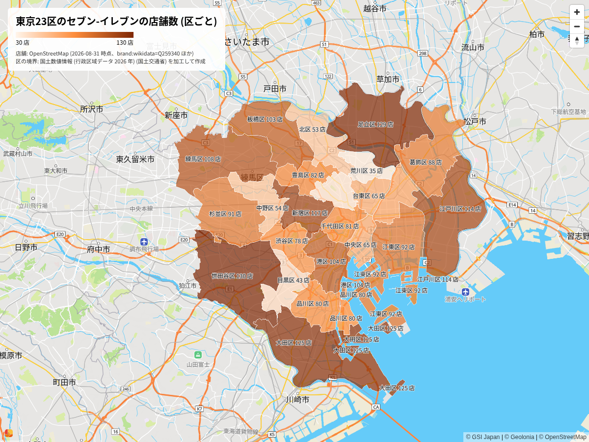
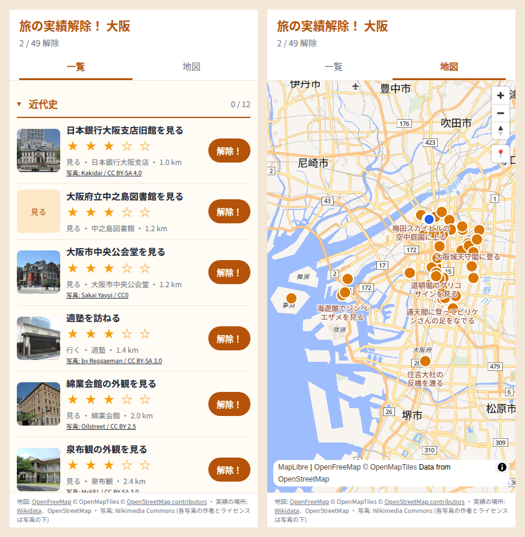

# geo-app-factory

「東京23区の区ごとのセブンイレブンの数を可視化したい」

この一言から、地図に載せるデータの出どころ、ライセンスと出典表示、描画ライブラリまでを、AI エージェントが根拠つきで選ぶためのスキル集。「地図アプリを作りたい」のような曖昧な依頼なら、何を作るかの聞き取りから始める。

## 作例 1: 区ごとの店舗数を地図で見る



上の図は、このスキルに沿って Claude Code が作ったもの (2026-11-10)。途中でエージェントがしたことは次のとおり。

- 公開の仕方を 1 問だけ聞いた (答えは「記事や資料で公開する」)。それで足切りの条件が決まる
- 店舗のデータを 3 つの出どころから取って数え比べた。OpenStreetMap は 1,944 店、Overture Maps は重複をまとめて約 2,150 店。AllThePlaces は全国 6,000 件で打ち切られていて、23 区は 0 件だった。会社の公表値は東京都全体で 2,945 店で、区ごとの数は無い
- 正解が無いので、どの出どころの数で描いたかと出典を図に書いた
- 区の境界は国土数値情報 (CC BY 4.0)。描画は Geolonia Maps の embed で、HTML の属性だけでコロプレス図にした

通しで見つかった足りない手順 (チェーン店の数え方、AllThePlaces の打ち切り、Overture の 2026 年の列名) は、その場でスキルに書き足した。記録は [examples/seven-eleven-tokyo23](examples/seven-eleven-tokyo23/) にある。

## 作例 2: 地図アプリを企画から公開まで

「旅先で定番の名所を訪れることを、ゲームの実績解除みたいに演出してくれるアプリがほしい」から始めて、何を作るかの聞き取り、置き場所、地図データ、ライブラリの順にスキルを通し、MapLibre GL JS と OpenFreeMap、Cloudflare の Workers と D1 で作って公開した。



- 聞き取りでは 1 問ずつ聞き、価値の芯を 2 回読み違えて、本人の答えで直した。外したことはスキルに書き足した
- 予算 0 円、OSS (Apache-2.0)、他の人も登録できるサービスにする前提で、置き場所とライブラリを選んだ
- 記録は [examples/unlock-your-trip](examples/unlock-your-trip/)、アプリは https://unlock-your-trip.yuiseki.workers.dev

## できること、できないこと

- できる: 依頼から要件を読み、足りなければ選択肢で聞く。候補を足切りの条件で外し、残りを同じ軸で比べる。料金、規約、ライセンスは確かめた日つきの reference から引き、答える前に公式のページで確かめ直すよう促す
- できない: 正しい件数や網羅率を保証すること。出どころ同士の食い違いは、隠さずに並べて見せる
- できない: 法的な判断。規約や条文から読んだことと推測を分けて書くところまで
- スキルは手順と事実の集まりで、プログラムは持たない。データを取って描くのはエージェントの道具 (DuckDB、osmium、ブラウザなど) で、道具が無い環境では比較と推奨までになる

## スキル

| スキル | 使う場面 | 状態 |
|---|---|---|
| [map-product-grilling](.agents/skills/map-product-grilling/SKILL.md) | 作りたい地図プロダクトの価値と機能が曖昧なとき、明確になるまで、選択肢つきの質問を 1 問ずつ重ねて問い詰める | 書いた |
| [map-research-competitor](.agents/skills/map-research-competitor/SKILL.md) | 似たサービスを探して開き、価値、データ、機能を比べて、使う、貢献する、違いを決めて作る、のどれにするかを本人が選ぶ | 書いた |
| [map-compare-arch](.agents/skills/map-compare-arch/SKILL.md) | 保存・計算・表現を、クラウド、エッジ、ブラウザ/アプリのどこに置くかを機能ごとに決める (自前配信、ブラウザの API の活用を含む) | 書いた |
| [map-compare-infra](.agents/skills/map-compare-infra/SKILL.md) | 地図タイルサービス (OSM, OpenFreeMap, Mapbox, Google Maps, Geolonia Maps, HERE, MapFan API など) を要件に照らして選ぶ | 書いた |
| [map-compare-library](.agents/skills/map-compare-library/SKILL.md) | 地図ライブラリ (Leaflet, MapLibre GL JS, Mapbox GL JS, Google Maps JS API, CesiumJS など)、ネイティブアプリ向け SDK、複数 SDK の抽象化層 (MapConductor など) を要件に照らして選ぶ | 書いた |
| [map-compare-data](.agents/skills/map-compare-data/SKILL.md) | 地図に載せる主題データ (OSM、Overture、国土数値情報、統計、チェーン店の店舗など) の出どころを選ぶ | 書いた |
| [map-legal-check](.agents/skills/map-legal-check/SKILL.md) | 公開の前に、帰属表示、ODbL、測量法、位置情報と個人情報、地図 API の規約を確かめる | 書いた |
| [map-compare-auth](.agents/skills/map-compare-auth/SKILL.md) | 認証と認可の仕組み、タイルやデータへのアクセス制御を選ぶ | 書いた |
| [map-compare-protocol](.agents/skills/map-compare-protocol/SKILL.md) | リアルタイムの配信と、地理空間の API の標準 (OGC API、WMS、NGSI-LD など) を選ぶ | 書いた |
| [map-ux-design](.agents/skills/map-ux-design/SKILL.md) | 地図の UI と UX (大量の地物、検索、現在地、モバイル、アクセシビリティ) を設計する | 書いた |
| [map-poc-measure](.agents/skills/map-poc-measure/SKILL.md) | タイル数、表示回数、データの大きさ、端末での動作を試作して測る | 書いた |
| [map-ops](.agents/skills/map-ops/SKILL.md) | API キー、利用量と予算、データの更新、障害時の切り替えを運用する | 書いた |
| [map-migrate](.agents/skills/map-migrate/SKILL.md) | Google Maps、Mapbox、Leaflet などからの乗り換えを計画する | 書いた |

進み具合は [.agents/skills/TODO.md](.agents/skills/TODO.md)。スキルの使い分けはエージェント向けに [AGENTS.md](AGENTS.md) に書く。

reference の事実 (料金、規約、ライセンス、版) は 2026-11-10 に確かめたもの。変わるので、使うときは公式のページで確かめ直す。

## 使い方

このリポジトリを開いて、エージェントに地図プロダクトのことを頼む。スキルは [Agent Skills](https://code.claude.com/docs/en/skills) の形 (`SKILL.md` を持つディレクトリ) で、`.agents/skills/` にある。

| エージェント | このリポジトリで読まれる場所 | 使い分けの案内 |
|---|---|---|
| Claude Code | `.claude/skills/` (`.agents/skills/` へのシンボリックリンク) | `CLAUDE.md` が `AGENTS.md` を読み込む |
| Codex | `.agents/skills/` | `AGENTS.md` を読む |
| Gemini CLI | `.agents/skills/` (`.gemini/skills/` の別名として読まれる) | |
| opencode | `.agents/skills/` か `.claude/skills/` | |

読まれる場所は 2026-11-11 に各エージェントの文書で確かめた (Claude Code https://code.claude.com/docs/en/skills 、Codex https://learn.chatgpt.com/docs/build-skills 、Gemini CLI https://geminicli.com/docs/cli/skills/ 、opencode https://opencode.ai/docs/skills)。

他のリポジトリに入れるときは、[skills](https://github.com/vercel-labs/skills) の CLI (Node.js 22.20 以降) を使う。

```sh
npx skills add yuiseki/geo-app-factory                          # 全部のスキル
npx skills add yuiseki/geo-app-factory --skill map-compare-library  # 1 つだけ
```

この CLI が入れるのはスキルのディレクトリだけで、リポジトリ直下の [AGENTS.md](AGENTS.md) (どの段階でどのスキルを使うかの案内) は入らない。流れに沿って使いたいときは、AGENTS.md の中身を入れ先の AGENTS.md に写す。スキルは 1 つずつでも働くように書いてある。

## 書き足すとき

`python3 scripts/check.py` で、frontmatter、SKILL.md の行数 (200 行まで)、リンク切れ、em ダッシュ、手元のパス、利害関係の開示の文面、TODO.md の一覧と件数を検査する。確認日 (「確かめた日」) が 90 日より古い reference は警告として出る。検査そのもののテストは `python3 -m unittest discover -s tests`。どちらも GitHub Actions で回る。スキルを書くときの決まりは [.agents/skills/AGENTS.md](.agents/skills/AGENTS.md)。

## 利害関係の開示

このスキル集の作者は、Geolonia Maps を提供する株式会社 Geolonia に関係している。作例 1 で Geolonia Maps を使ったのは、HTML の属性だけでコロプレス図を描ける機能を試すためである。作例 2 は Geolonia の製品を使っていない。スキルは Geolonia Maps を特別扱いしない。

## ディレクトリ構成

```
AGENTS.md                 エージェント向け: どのスキルをいつ使うか
CLAUDE.md                 Claude Code 向け: AGENTS.md を読み込むだけ
LICENSE                   Apache License 2.0
.claude/skills -> ../.agents/skills
.agents/skills/
  AGENTS.md               スキルを書く人向けの決まり
  TODO.md                 執筆の進み具合
  map-product-grilling/
  map-research-competitor/
  map-compare-arch/
  map-compare-infra/
  map-compare-library/
  map-compare-data/
  map-legal-check/
  map-ux-design/
  map-poc-measure/
  map-ops/
  map-compare-auth/
  map-compare-protocol/
  map-migrate/
docs/images/              README の図
scripts/check.py          公開前の検査 (tests/ にそのテスト)
examples/                 スキルを通した記録 (seven-eleven-tokyo23、unlock-your-trip)
```

## ライセンス

[Apache License 2.0](LICENSE)。

ただし、作例の図とデータ ([docs/images/seven-eleven-tokyo23.png](docs/images/seven-eleven-tokyo23.png)、[examples/seven-eleven-tokyo23/](examples/seven-eleven-tokyo23/) の `wards.geojson` と `counts.tsv`) は、元のデータのライセンスと出典表示に従う。店舗は © OpenStreetMap contributors (ODbL 1.0) と Overture Maps Foundation、区の境界は国土数値情報 (行政区域データ) (国土交通省) を加工して作成 (CC BY 4.0)、図の背景の地図は © Geolonia、© OpenStreetMap、© GSI Japan。
