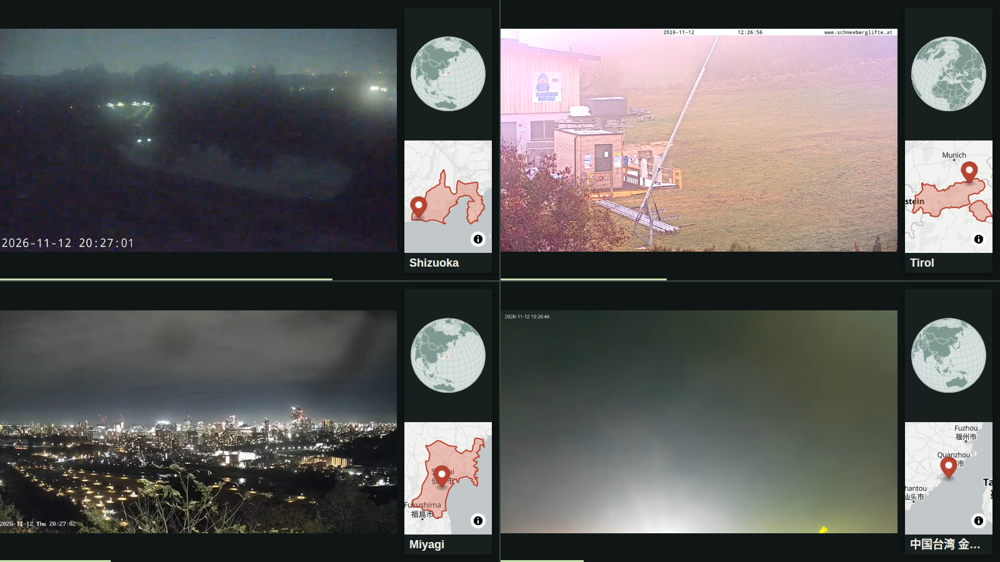

# geo-software-factory

`geo-software-factory` は、ソフトウェアファクトリー レベル5、「ダークファクトリー（Dark Factory）」を実現するためのスキルとハーネスです。ソフトウェアファクトリーについては [WHAT_IS_SOFTWARE_FACTORY.md](WHAT_IS_SOFTWARE_FACTORY.md)、ダークファクトリーについては [WHAT_IS_DARK_FACTORY.md](WHAT_IS_DARK_FACTORY.md) を参照。

「地図アプリ・サービスのアイデアがあるんだけど……」

この一言から、実現したいアイデアと生み出したい価値を明確にするために、いくつかの質問をする。その後は、AI エージェントが自律的にアイデアをソフトウェアとして実現する。地図のデータ、API、ライブラリなどの知識は一切要らない。AI エージェントが、あらゆる選択肢の中から最も合理的なものを調べ、根拠つきで自律的に技術を選ぶ。実装の正しさは、人間のコードレビューではなく、実装から切り離した別の AI エージェントの評価で判定するので、人間がコードをチェックする必要はない。人間がするのは、最初の質問に答えて、何をもって完成とするかの基準を一緒に決めることだけである。

## こういう人に使ってほしい

- 地図アプリやサービスのアイデアはあるが、地図のソフトウェアの知識や経験がまったく、またはほとんどない人
- アイデアも知識も経験もあるが、膨大な選択肢の中から毎回どれを選ぶのが本当に一番よいのかに悩み、疲れている人

## 選択肢を最初から狭めない

地図の技術選定は、知っている製品や流行りのライブラリから始めると、もっと合う選択肢を見落とす。このスキル集は、次の 2 つを、あらゆる選択肢を候補に入れたうえで、要件から合理的に最適なものをエージェントが自律的に決めることを目指す。

- 地図タイルの供給元: 商用の API、無償の公開タイル、公的なタイルに加え、タイルを自分で作って配る自前配信 (セルフホスト) も同じ軸で並べる。足切りの条件 (利用形態、対象地域、通信、規約)、地図の詳しさ、規模ごとの費用と、自前配信との損益分岐で比べて決める (geo-software-arch の [self-hosting](.agents/skills/geo-software-arch/references/self-hosting.md)、[geo-software-infra](.agents/skills/geo-software-infra/SKILL.md))。
- 地図の描画ライブラリ: Web とネイティブのライブラリ、クロスプラットフォーム、Python、サーバーでの描画、地図アプリの土台に加え、ライブラリを使わずに依頼専用の描画器を書くフルスクラッチ (full-scratch) も候補に入れる。対象端末、タイルの供給元との組み合わせ、ライセンス、描画の能力、性能、保守の体制で比べて決める ([geo-software-library](.agents/skills/geo-software-library/SKILL.md)、[full-scratch](.agents/skills/geo-software-library/references/full-scratch.md))。

どちらも、決めるのは人間ではなくエージェントで、人間は昼に要件と判断の方針 (費用の上限、公開の範囲、迷ったときの既定) を渡すだけにする。エージェントは、選んだ理由と、選ばなかった候補を外した理由を、プロダクト概要に残す。最適は要件で変わる。月に数百回の表示なら外部の供給元と汎用のライブラリが合理的なことが多い。だが表示が多い、閉域網、地図の中身を自分で決めたいなら自前配信が、性能やフットプリントを極端に重く見るなら full-scratch が、最適になりうる。特定の製品を既定の答えにはしない。

## 作例 1: 区ごとの店舗数を地図で見る


上の図は、このスキルに沿って Claude Code が作ったもの (2026-11-10)。途中でエージェントがしたことは次のとおり。

- 公開の仕方を 1 問だけ聞いた (答えは「記事や資料で公開する」)。それで足切りの条件が決まる
- 店舗のデータを 3 つの出どころから取って数え比べた。OpenStreetMap は 1,944 店、Overture Maps は重複をまとめて約 2,150 店。AllThePlaces は全国 6,000 件で打ち切られていて、23 区は 0 件だった。会社の公表値は東京都全体で 2,945 店で、区ごとの数は無い
- 正解が無いので、どの出どころの数で描いたかと出典を図に書いた
- 区の境界は国土数値情報 (CC BY 4.0)。描画は Geolonia Maps の embed で、HTML の属性だけでコロプレス図にした

通しで見つかった足りない手順 (チェーン店の数え方、AllThePlaces の打ち切り、Overture の 2026 年の列名) は、その場でスキルに書き足した。記録は [examples/seven-eleven-tokyo23](examples/seven-eleven-tokyo23/) にある。

## 作例 2: 地図アプリを企画から公開まで

「旅先で定番の名所を訪れることを、ゲームの実績解除みたいに演出してくれるアプリがほしい」から始めて、何を作るかの聞き取り、置き場所、地図データ、ライブラリの順にスキルを通し、MapLibre GL JS と OpenFreeMap、Cloudflare の Workers と D1 で作って公開した。


- 聞き取りでは 1 問ずつ聞き、価値の芯を 2 回読み違えて、本人の答えで直した。外したことはスキルに書き足した
- 予算 0 円、OSS (Apache-2.0)、他の人も登録できるサービスにする前提で、置き場所とライブラリを選んだ
- 記録は [examples/unlock-your-trip](examples/unlock-your-trip/)、アプリは https://trip.yuiseki.net

## 作例 3: ライブカメラで世界を眺める

部屋で過ごしながら世界のどこかと繋がっている感覚を得る、という価値から始めて、公開ライブカメラを 4 画面で巡り、それぞれに地球と詳細地図を添える壁紙のようなページを作った。MapLibre GL JS と OpenFreeMap、Natural Earth の行政区画で、Cloudflare Workers に置いている。



- 小さな地球でカメラの所在国を塗り、詳細地図ではカメラが属する行政区画を塗ってピンを立てる。行政区画との照合は、エージェントが Natural Earth とカメラの位置から作った
- カメラの一覧は出典と再配布の条件を確かめていないので、リポジトリには形式の見本だけを置いた
- 記録は [examples/livecam-wallpaper](examples/livecam-wallpaper/)、ページは https://livecams.yuiseki.net

## できること、できないこと

- できる: 依頼から要件を読み、足りなければ選択肢で聞く。候補を足切りの条件で外し、残りを同じ軸で比べる。料金、規約、ライセンスは確かめた日つきの reference から引き、答える前に公式のページで確かめ直すよう促す
- できない: 正しい件数や網羅率を保証すること。出どころ同士の食い違いは、隠さずに並べて見せる
- できない: 法的な判断。規約や条文から読んだことと推測を分けて書くところまで
- スキルは手順と事実が中心で、判定できることだけを小さなプログラムにする (下の「プログラムが保証すること、スキルが導くこと」)。データを取って描くのはエージェントの道具 (DuckDB、osmium、ブラウザなど) で、道具が無い環境では比較と推奨までになる

## スキル

| スキル | 使う場面 | 状態 |
|---|---|---|
| [geo-software-product-grilling](.agents/skills/geo-software-product-grilling/SKILL.md) | 作りたい地図プロダクトの価値と機能が曖昧なとき、明確になるまで、選択肢つきの質問を 1 問ずつ重ねて問い詰める | 書いた |
| [geo-software-research-competitor](.agents/skills/geo-software-research-competitor/SKILL.md) | 似たサービスを探して開き、価値、データ、機能を比べて、使う、貢献する、違いを決めて作る、のどれにするかを本人が選ぶ | 書いた |
| [geo-software-arch](.agents/skills/geo-software-arch/SKILL.md) | 保存・計算・表現を、クラウド、エッジ、ブラウザ/アプリのどこに置くかを機能ごとに決める (自前配信、ブラウザの API の活用を含む) | 書いた |
| [geo-software-infra](.agents/skills/geo-software-infra/SKILL.md) | 地図タイルサービス (OSM, OpenFreeMap, Mapbox, Google Maps, Geolonia Maps, HERE, MapFan API など) を要件に照らして選ぶ | 書いた |
| [geo-software-library](.agents/skills/geo-software-library/SKILL.md) | 地図ライブラリ (Leaflet, MapLibre GL JS, Mapbox GL JS, Google Maps JS API, CesiumJS など)、ネイティブアプリ向け SDK、複数 SDK の抽象化層 (MapConductor など) を要件に照らして選ぶ | 書いた |
| [geo-software-data](.agents/skills/geo-software-data/SKILL.md) | 地図に載せる主題データ (OSM、Overture、国土数値情報、統計、チェーン店の店舗など) の出どころを選ぶ | 書いた |
| [geo-software-legal-check](.agents/skills/geo-software-legal-check/SKILL.md) | 公開の前に、帰属表示、ODbL、測量法、位置情報と個人情報、地図 API の規約を確かめる | 書いた |
| [geo-software-auth](.agents/skills/geo-software-auth/SKILL.md) | 認証と認可の仕組み、タイルやデータへのアクセス制御を選ぶ | 書いた |
| [geo-software-protocol](.agents/skills/geo-software-protocol/SKILL.md) | リアルタイムの配信と、地理空間の API の標準 (OGC API、WMS、NGSI-LD など) を選ぶ | 書いた |
| [geo-software-ux-design](.agents/skills/geo-software-ux-design/SKILL.md) | 地図の UI と UX (大量の地物、検索、現在地、モバイル、アクセシビリティ) を設計する | 書いた |
| [geo-software-poc-measure](.agents/skills/geo-software-poc-measure/SKILL.md) | タイル数、表示回数、データの大きさ、端末での動作を試作して測る | 書いた |
| [geo-software-ops](.agents/skills/geo-software-ops/SKILL.md) | API キー、利用量と予算、データの更新、障害時の切り替えを運用する | 書いた |
| [geo-software-migrate](.agents/skills/geo-software-migrate/SKILL.md) | Google Maps、Mapbox、Leaflet などからの乗り換えを計画する | 書いた |
| [geo-software-eval](.agents/skills/geo-software-eval/SKILL.md) | 正しさをコードレビューではなく評価で判定する。昼に人間と外から観測できるシナリオを作り、夜は実装と別の評価者が手元と本番で判定し、評価そのものも確かめる。人間の確認は評価の証拠で 1 つずつ外す | 書いた |
| [geo-software-build](.agents/skills/geo-software-build/SKILL.md) | 技術選定の済んだものを、テストを先に書いて実装し、データを出典つきで組み立て、画面まで確かめる | 書いた |
| [geo-software-tdd](.agents/skills/geo-software-tdd/SKILL.md) | 人間が見る前に品質を上げきるため、試験を先に書き、CI で落とす仕組みを組む。地図のライブラリ (MapLibre、Leaflet、OpenLayers、CesiumJS、deck.gl、MapLibre Native、mln-rs、ezu、forge3d、RustGIS、GeoPandas ほか) と OSS の地図アプリの試験と CI の作法を、出典つきでまとめた | 書いた |
| [geo-software-security-audit](.agents/skills/geo-software-security-audit/SKILL.md) | 実装と別の監査者が、誰でも使える入口から認証、認可、注入、濫用、露出を調べる。漏れだけでなく、登録し放題、巨大な要求、メールの送られ放題、従量課金の食い潰しで壊れることも数え、確かめた問題を評価のシナリオにする | 書いた |
| [geo-software-deploy](.agents/skills/geo-software-deploy/SKILL.md) | 昼に与えられた権限の範囲で出し、本番の URL で確かめる。リポジトリの公開前の点検も | 書いた |
| [geo-software-swarm](.agents/skills/geo-software-swarm/SKILL.md) | 公開したあと、定期実行のエージェントの群れと掲示板 (GitHub) で長い尾を処理し続ける。統治の層を掛け、進み具合を届いて持ちこたえた変更で測る | 書いた |

進み具合は [.agents/skills/TODO.md](.agents/skills/TODO.md)。スキルの使い分けはエージェント向けに [AGENTS.md](AGENTS.md) に書く。

reference の事実 (料金、規約、ライセンス、版) は 2026-11-10 に確かめたもの。変わるので、使うときは公式のページで確かめ直す。

## 使い方

このリポジトリを開いて、エージェントに地図プロダクトのことを頼む。スキルは [Agent Skills](https://code.claude.com/docs/en/skills) の形 (`SKILL.md` を持つディレクトリ) で、`.agents/skills/` にある。

| エージェント | このリポジトリで読まれる場所 | 使い分けの案内 |
|---|---|---|
| Claude Code | `.claude/skills/` (`.agents/skills/` へのシンボリックリンク) | `CLAUDE.md` が `AGENTS.md` を読み込む |
| Codex | `.agents/skills/` | `AGENTS.md` を読む |
| Gemini CLI | `.agents/skills/` (`.gemini/skills/` の別名として読まれる) | |
| opencode | `.agents/skills/` か `.claude/skills/` | |

読まれる場所は 2026-11-11 に各エージェントの文書で確かめた (Claude Code https://code.claude.com/docs/en/skills 、Codex https://learn.chatgpt.com/docs/build-skills 、Gemini CLI https://geminicli.com/docs/cli/skills/ 、opencode https://opencode.ai/docs/skills)。

他のリポジトリに入れるときは、[skills](https://github.com/vercel-labs/skills) の CLI (Node.js 22.20 以降) を使う。

```sh
npx skills add yuiseki/geo-software-factory                       # 全部のスキル
npx skills add yuiseki/geo-software-factory --skill geo-software-library  # 1 つだけ
```

この CLI が入れるのはスキルのディレクトリだけで、リポジトリ直下の [AGENTS.md](AGENTS.md) (どの段階でどのスキルを使うかの案内) は入らない。流れに沿って使いたいときは、AGENTS.md の中身を入れ先の AGENTS.md に写す。スキルは 1 つずつでも働くように書いてある。

## プログラムが保証すること、スキルが導くこと

スキルは手順と知識で、エージェントが従うかどうかは保証しない。同じスキルでも、エージェントやモデルによって結果は変わる。そこで、判定できるものはプログラムにし、スキルの効きは測る。

| プログラムが判定する | 道具 |
|---|---|
| 配る GeoJSON の形、度の範囲、緯度と経度の取り違え、範囲の外、リングの閉じと自己交差、必ず要る属性 | [geocheck.py](.agents/skills/geo-software-eval/scripts/geocheck.py) |
| 本番の疎通、状態コード、応答時間、`.git` や `.env` の露出、セキュリティのヘッダ、source map | [smoke.py](.agents/skills/geo-software-deploy/scripts/smoke.py) |
| 昼から夜へ渡すプロダクト概要がそろっているか (価値の芯、Must、シナリオの置き場所、判断の方針、鍵の名前が設定済みか、CLI があるか。値は読まない) | [check_brief.py](.agents/skills/geo-software-product-grilling/scripts/check_brief.py) |
| 実装と切り離したシナリオを動かし、実装者には症状だけを返す (シナリオと報告が実装のリポジトリの中にあれば拒む。閾値とシナリオの本文は返さない) | [run_eval.py](.agents/skills/geo-software-eval/scripts/run_eval.py) |
| 実装者と評価者を別のコンテナに分け、実装者の側からシナリオが見えないことを、目印を置いて探させて確かめる (評価者の側で見つかることを対照にする) | [compose.yaml](.agents/skills/geo-software-eval/assets/isolation/compose.yaml)、[check_isolation.py](.agents/skills/geo-software-eval/scripts/check_isolation.py)、[eval_watch.py](.agents/skills/geo-software-eval/scripts/eval_watch.py) |
| 外部の地図サービスの代役 (手元のタイルと決まった答え、Range、5xx、429、空や途中で切れた応答、遅れを回数で決めて起こす) | [twin.py](.agents/skills/geo-software-eval/scripts/twin.py) |
| 夜の前の preflight、評価の評価 (壊した版で落ちるか)、夜の自律ループ、クリーン checkout の最終判定、朝の報告の生成 | [dark_factory.py](.agents/skills/geo-software-eval/scripts/dark_factory.py) |
| 無人の実行の停止スイッチ、評価の症状と残り時間を道具の呼び出しのたびに届ける、終わろうとしたら上限つきで観点を 1 つずつ返す | [hooks.py](.agents/skills/geo-software-swarm/scripts/hooks.py)、[設定のひな形](.agents/skills/geo-software-swarm/assets/unattended-settings.json) |
| 群れの 1 回 1 仕事の起床ループ、統治の関門 (保護パス・検査緩和の検出と人間の承認強制)、届いて持ちこたえた変更と逃げた不具合の集計 | [swarm.py](.agents/skills/geo-software-swarm/scripts/swarm.py) |
| スキル集そのもの (frontmatter、行数、リンク、確認日、TODO の件数) | [scripts/check.py](scripts/check.py) |
| スキルあり、なしで、同じエージェントが課題を解けるか | [evals/](evals/README.md) |

スキルが導くだけのもの (まだプログラムで判定していないもの): 要件の聞き出し、データの出どころの選び方、ライセンスと規約の解釈、技術の選定、画面の設計。これらは、geo-software-eval のシナリオ (人間が昼に作り、別の評価者が判定する) と、evals の判断の課題で確かめる。evals の結果は [evals/results.md](evals/results.md) に置く。

## 書き足すとき

`python3 scripts/check.py` で、frontmatter、SKILL.md の行数 (200 行まで)、リンク切れ、em ダッシュ、手元のパス、利害関係の開示の文面、TODO.md の一覧と件数を検査する。確認日 (「確かめた日」) が 90 日より古い reference は警告として出る。検査そのもののテストは `python3 -m unittest discover -s tests`、スキルに入れたスクリプトのテストは各スキルの `scripts/` の `test_*.py`、evals の道具のテストは `evals/test_bench.py`。どれも GitHub Actions で回る。スキルを書くときの決まりは [.agents/skills/AGENTS.md](.agents/skills/AGENTS.md)。

## 利害関係の開示

このスキル集の作者は、Geolonia Maps を提供する株式会社 Geolonia に関係している。作例 1 で Geolonia Maps を使ったのは、HTML の属性だけでコロプレス図を描ける機能を試すためである。作例 2 は Geolonia の製品を使っていない。スキルは Geolonia Maps を特別扱いしない。

## ディレクトリ構成

```
AGENTS.md                 エージェント向け: どのスキルをいつ使うか
CLAUDE.md                 Claude Code 向け: AGENTS.md を読み込むだけ
LICENSE                   Apache License 2.0
.claude/skills -> ../.agents/skills
.agents/skills/
  AGENTS.md               スキルを書く人向けの決まり
  TODO.md                 執筆の進み具合
  geo-software-product-grilling/
  geo-software-research-competitor/
  geo-software-arch/
  geo-software-infra/
  geo-software-library/
  geo-software-data/
  geo-software-legal-check/
  geo-software-ux-design/
  geo-software-poc-measure/
  geo-software-ops/
  geo-software-auth/
  geo-software-protocol/
  geo-software-migrate/
  geo-software-eval/      scripts/geocheck.py を含む
  geo-software-build/
  geo-software-tdd/
  geo-software-security-audit/
  geo-software-deploy/    scripts/smoke.py を含む
  geo-software-swarm/
docs/images/              README の図
scripts/check.py          公開前の検査 (tests/ にそのテスト)
evals/                    スキルの効きを測る課題と道具 (作業場所には入らない)
examples/                 スキルを通した記録 (seven-eleven-tokyo23、unlock-your-trip、livecam-wallpaper)
```

## ライセンス

[Apache License 2.0](LICENSE)。

ただし、作例の図とデータ ([docs/images/seven-eleven-tokyo23.png](docs/images/seven-eleven-tokyo23.png)、[examples/seven-eleven-tokyo23/](examples/seven-eleven-tokyo23/) の `wards.geojson` と `counts.tsv`) は、元のデータのライセンスと出典表示に従う。店舗は © OpenStreetMap contributors (ODbL 1.0) と Overture Maps Foundation、区の境界は国土数値情報 (行政区域データ) (国土交通省) を加工して作成 (CC BY 4.0)、図の背景の地図は © Geolonia、© OpenStreetMap、© GSI Japan。
