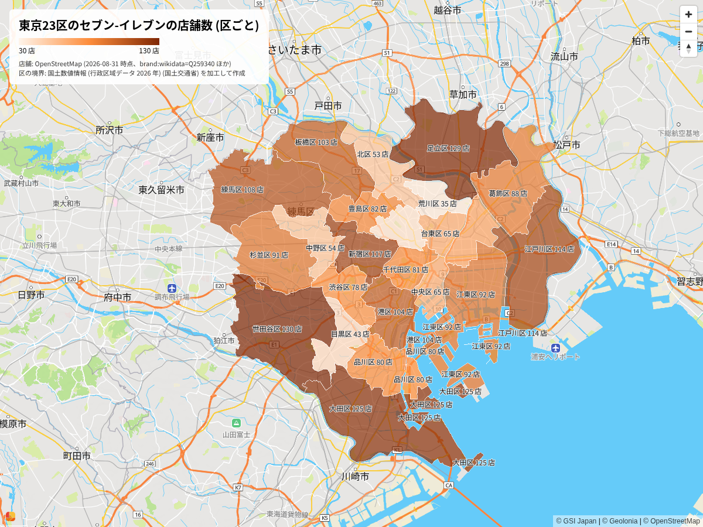

# 東京 23 区の区ごとのセブン-イレブンの数

「東京都 23 区の区ごとのセブン-イレブンの数を可視化したい」という依頼を、このリポジトリのスキルに沿って Claude Code が通した記録 (2026-11-10)。利用形態は「記事や資料で公開する (商用ではない)」として進めた。

## 使ったスキルと、決めたこと

| 段階 | スキル | 決めたこと |
|---|---|---|
| データの出どころ | geo-software-data | 店舗は OSM、確かめ用に Overture Maps の places と AllThePlaces。区の境界は国土数値情報の行政区域 (N03) 2026 年版 (CC BY 4.0) |
| 描き方 | geo-software-library | Geolonia Maps の embed v6 のコロプレス (HTML の属性だけ)。静止画として撮る |
| 公開の前 | geo-software-legal-check | OSM (ODbL) と国土数値情報の出典表示、Geolonia Maps の地図の静止画の扱い |

## 数え比べた結果

区ごとの数は [counts.tsv](counts.tsv)。23 区の合計は次のとおり。

| 出どころ | 件数 | 絞り方 |
|---|---|---|
| OpenStreetMap (凍結データ 2026-08-31) | 1,944 | `shop=convenience` で `brand:wikidata=Q259340` (1,928)、または `brand:wikidata` が無く名前がセブン-イレブン (15)。面は代表点にした |
| Overture Maps places (2026-10-21.0) | 2,669 (30 m 以内をまとめると約 2,150) | `brand.wikidata = 'Q259340'` か名前の一致で、`basic_category = 'convenience_store'`。重複を含む |
| AllThePlaces (`seven_eleven_jp`、2026-11-05 収集) | 0 | 全国でちょうど 6,000 件で打ち切られており、東京都の店舗が入っていなかった |
| セブン-イレブン・ジャパンの公表値 | 東京都全体で 2,945 (2026 年 10 月末) | 区ごとの数は公表されていない |

この図は区ごとの店舗数をそのまま塗っている。区の面積と人口は大きく違うので、区どうしを比べるなら、面積あたりか人口あたりに直したほうがよい (geo-software-ux-design の cartography)。依頼が「区ごとの数」だったので、数のまま描いた。

区ごとの正解の数は手に入らなかったので、図は OSM の数で描き、そのことを図に書いた。Overture の数は区ごとに OSM の 1.15 倍 (台東区) から 1.63 倍 (荒川区) で、この差は、取りこぼしと重複のどちらが大きいかを確かめられていない。

## ファイル

- [index.html](index.html): 図のページ。手元のサーバーで開き、ブラウザで撮った。`YOUR-API-KEY` は localhost などで使えるデモキーで、本番のドメインでは Geolonia の API キーが要る
- [wards.geojson](wards.geojson): 区の境界と OSM の店舗数 (`count`)。国土数値情報 (行政区域データ 2026 年) (国土交通省) を加工して作成。店舗数は OpenStreetMap のデータから数えた
- [counts.tsv](counts.tsv): 区ごとの OSM と Overture の数
- [overture_query.py](overture_query.py): Overture の places を DuckDB 1.5.5 で範囲を絞って読むクエリ

## 出典

- 店舗: © OpenStreetMap contributors (ODbL 1.0)、Overture Maps Foundation (places の出所ごとのライセンス)
- 区の境界: 国土数値情報 (行政区域データ) (国土交通省) を加工して作成 (CC BY 4.0)
- 背景の地図: © Geolonia、© OpenStreetMap、© GSI Japan
