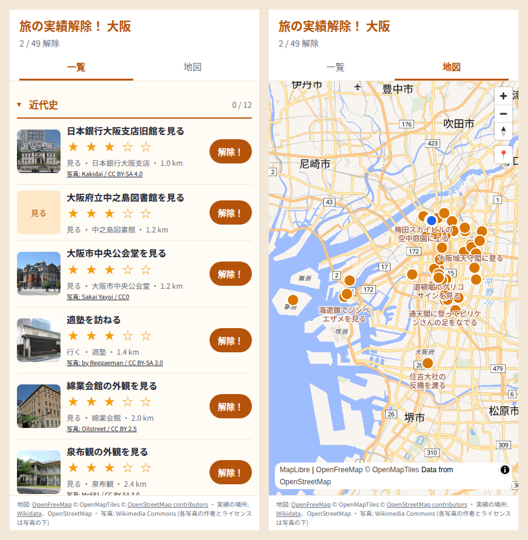

# 旅の実績解除！ (unlock-your-trip)

「旅先で定番の名所を訪れることを、ゲームの実績解除みたいに演出してくれるアプリがほしい」という依頼を、このリポジトリのスキルの 4 段階 (geo-software-product-grilling、geo-software-arch、geo-software-infra、geo-software-library) に沿って Claude Code が企画から公開まで通した記録 (2026-11-10)。

- アプリ: https://unlock-your-trip.yuiseki.workers.dev
- ソース: https://github.com/yuiseki/unlock-your-trip (Apache-2.0)

## 段階ごとに決めたこと

| 段階 | スキル | 決めたこと |
|---|---|---|
| 何を作るか | geo-software-product-grilling | 1 問ずつ 20 問ほど聞いた。最重要の価値は「解除すべき実績が簡潔な一覧になっていて、眺めて好きに選んで取りに行ける」こと。演出、見返す、人に見せるは副次的。最初の版の Must は「一覧 (地図と切り替え、現在地つき)」と「解除が確実に記録されること」の 2 つ |
| 何をどこに置くか | geo-software-arch | Cloudflare の Workers (静的アセットと API) と D1。押したら端末の IndexedDB に先に書き、つながったら送る。Supabase の無料プランは 1 週間使わないと止まるので外した。予算 0 円 |
| どの地図データか | geo-software-infra | OpenFreeMap。無料、キー不要、表示回数の上限なし。既定のスタイルの注記を日本語だけに直して使う |
| どのライブラリで描くか | geo-software-library | MapLibre GL JS 6 系 (BSD 3-Clause)。地図のタブを開いたときだけ読み込む |
| 実績の一覧 | geo-software-data、geo-software-legal-check | 場所は Wikidata (CC0) と OpenStreetMap、名所の写真は Wikimedia Commons を作者とライセンスつきで |

## 聞き取りで外したこと

geo-software-product-grilling の「やってはいけないこと」に書き足した。

- 価値の芯を「解除の瞬間の演出」「地図が主役」と推測して、2 回外した
- 価値の順番が変わったあと、Must を聞き直すまで 5 つのままだった (聞き直して 2 つになった)
- 実績の件数を「数百件」と推測で書いた。本人が示した過去の記録では、1 つの旅で最多 80 件ほどだった
- 分類を別の土地 (広島の「交通」) から引き写した。大阪には「近代史」「食い倒れ」「水都」が立った

## 通しでスキルに足りなかったこと

その場でスキルに書き足した。

- Wikidata の使い方と回数の制限 (geo-software-data の [wikidata](../../.agents/skills/geo-software-data/references/sources/wikidata.md))
- Wikimedia Commons の写真の帰属 (geo-software-legal-check の attribution)
- Cloudflare D1 と Supabase の無料枠の挙動 (geo-software-arch)
- MapLibre GL JS 6 を Vite で使うときのワーカーの読み込み方 (geo-software-library)
